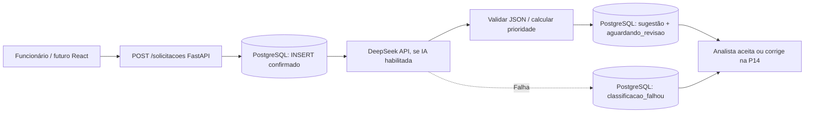

# AI Request Classifier

Aplicação de triagem de solicitações internas. O MVP permitirá cadastrar chamados, receber sugestões automáticas de classificação e permitir que um analista aceite ou corrija cada sugestão.

> **Estado em 15/10/2026:** P01–P12 concluídas (25 testes aprovados na P12). **P13 em validação final:** chamada real à DeepSeek com sucesso no POST da solicitação #13, classificação persistida segundo a resposta da API e estado `aguardando_revisao`. O fallback para falha de autenticação também foi observado no POST #8 (`classificacao_falhou`, cadastro mantido). **Ainda faltam confirmar GET posterior, suíte automatizada completa da P13 e commit/push.** React e revisão humana serão implementados na P14. Repositório privado até a auditoria final e autorização.

## Problema empresarial

Solicitações internas chegam sem classificação padronizada. Isso exige triagem manual e pode causar encaminhamento inconsistente. O sistema propõe reduzir esse trabalho por meio de sugestões de IA verificáveis e revisão humana; **classificação não equivale a resolver o chamado**.

## Fluxo alvo



A integração implementada na P13 executa a chamada **sincronamente após o COMMIT do cadastro**. O tempo de resposta do POST inclui a latência externa da IA; processamento assíncrono e filas poderão ser estudados após o MVP.

## Stack

Python 3.14 (ambiente local do desenvolvedor), FastAPI, Pydantic, PostgreSQL 18.6 (Windows na porta `5433`), psycopg, python-dotenv, pytest e biblioteca padrão `urllib.request` para a API HTTP DeepSeek.

## Arquivos centrais

```text
backend/
  app/
    main.py                  # inicialização FastAPI e /health
    database.py              # conexão PostgreSQL e carregamento de .env
    schemas.py               # entrada HTTP
    classificacao.py         # taxonomia e matriz determinística P12
    ia.py                    # chamada LLM e validação JSON P13
    triagem.py               # orquestração da sugestão após INSERT P13
    routes/solicitacoes.py   # CRUD, POST com acionamento automático P13
  sql/
    001_create_solicitacoes.sql
    002_add_classificacao_ia.sql
  tests/
    test_api.py
    test_classificacao.py
    test_ia.py
    test_triagem.py
  evaluation/casos_referencia.json
  .env.example
  requirements.txt
  requirements-dev.txt
docs/
  ARQUITETURA.md
  CRITERIOS_CLASSIFICACAO.md
  PLANO_DE_ESTUDOS_E_DICAS.md
```

## Configuração local (PowerShell)

Na raiz do repositório:

```powershell
cd D:\Projects\ai-request-classifier
.\backend\.venv\Scripts\python.exe -m pip install -r .\backend\requirements-dev.txt
```

O arquivo `backend/.env` contém a senha PostgreSQL e, quando habilitada, a chave de API da DeepSeek. **Nunca versione `.env`.** Adicione as variáveis `AI_ENABLED`, `DEEPSEEK_API_KEY` e `AI_MODEL` ao `.env` existente a partir de `.env.example`, preservando suas credenciais PostgreSQL.

A configuração de IA inicia desligada:

```dotenv
AI_ENABLED=false
DEEPSEEK_API_KEY=SUBSTITUA_LOCALMENTE
AI_MODEL=deepseek-flash
```

### Migração incremental da P13

Depois de confirmar o banco correto, executar **nos dois bancos**:

```powershell
psql -U postgres -h 127.0.0.1 -p 5433 -d ai_request_classifier -v ON_ERROR_STOP=1 -f .\backend\sql\002_add_classificacao_ia.sql
psql -U postgres -h 127.0.0.1 -p 5433 -d ai_request_classifier_test -v ON_ERROR_STOP=1 -f .\backend\sql\002_add_classificacao_ia.sql
```

Não recrie as bases nem execute `TRUNCATE` no banco de desenvolvimento.

### Testes sem custo de IA

Na pasta `backend`, mantenha `AI_ENABLED=false` para a suíte existente. Os novos testes de integração usam IA simulada (mock):

```powershell
cd backend
$env:AI_ENABLED = "false"
.\.venv\Scripts\python.exe -m pytest -q
Remove-Item Env:\AI_ENABLED
```

Os testes com PostgreSQL limpam o banco **exclusivo** `ai_request_classifier_test`. Confirme que ele não contém dados importantes. **A suíte completa após a integração real da P13 ainda precisa ser confirmada pelo desenvolvedor.**

### Teste real da integração

Configure uma chave válida em `backend/.env`, altere `AI_ENABLED=true`, inicie:

```powershell
cd D:\Projects\ai-request-classifier\backend
.\.venv\Scripts\python.exe -m uvicorn app.main:app --reload
```

Abra `http://127.0.0.1:8000/docs` e execute `POST /solicitacoes` com dados fictícios. A resposta esperada após chamada válida tem `status=aguardando_revisao`, categoria, impacto, urgência, prioridade e justificativa. **Observado no POST #13:** `suporte_ti`, impacto `equipe`, urgência `alta`, prioridade `alta`, 329 tokens de entrada, 54 tokens de saída e latência de 1.012 ms. **O GET posterior ainda precisa ser confirmado.** Caso a API externa falhe, o cadastro deve permanecer com `status=classificacao_falhou`, como ocorreu com o POST #8 após HTTP 401. Sem IA habilitada, mantém `pendente_classificacao`.

## Endpoints atuais

| Método | Rota | Função |
|---|---|---|
| GET | `/health` | Saúde básica |
| POST | `/solicitacoes` | Grava, tenta IA automaticamente se habilitada e retorna cadastro |
| GET | `/solicitacoes` | Lista registros e sugestões |
| GET | `/solicitacoes/{id}` | Consulta |
| PUT | `/solicitacoes/{id}` | Edita título/descrição (não reclassifica) |
| DELETE | `/solicitacoes/{id}` | Remove |

## Regras e métricas

- Categorias: TI, Acessos, Financeiro, RH e Outros (códigos em `classificacao.py`).
- O modelo propõe categoria, impacto, urgência e justificativa. O backend valida esses campos com Pydantic.
- A prioridade final é **determinística**, calculada pela matriz da P12.
- O sistema registra modelo, tokens reportados e tempo de resposta em milissegundos. **Uma amostra real observada:** 329 tokens de entrada, 54 tokens de saída e 1.012 ms; uma execução não representa a latência típica. Custo por classificação e estatísticas de desempenho ainda precisam ser medidos.
- Dados do chamado são enviados à API externa quando habilitada: usar **somente dados fictícios** durante o exercício e nunca enviar segredos ou dados pessoais reais.
- Não há autenticação, autorização, workflow de revisão concluído, controle de reprocessamento ou mecanismo de fila. **Não expor a API à internet.**

## Próximas etapas

P13: confirmar GET da solicitação #13, testes de regressão e commit/push; P14: React e revisão humana; P15: avaliação com os 10 casos da P12, qualidade, documentação comercial, medidas reais, auditoria de segredos, licença e publicação somente após autorização expressa.
