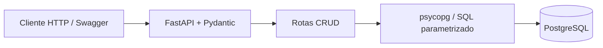

# AI Request Classifier

API para triagem de solicitações internas, com evolução planejada para **classificação automática por inteligência artificial e revisão humana**.

> **Estado do projeto — P11 em validação:** CRUD com FastAPI e PostgreSQL implementado; testes locais informados como funcionais pelo desenvolvedor. A persistência após reiniciar o Uvicorn e a revisão final de segurança/Git ainda precisam de confirmação específica. **A classificação por IA e a interface React ainda não foram implementadas.**

## Problema de negócio

Solicitações internas podem chegar com informações e prioridades heterogêneas, exigindo triagem manual repetitiva. O objetivo do produto é padronizar a entrada e, em etapas futuras, apoiar o analista com sugestões rastreáveis de categoria, prioridade e justificativa.

**Fluxo planejado:** funcionário cadastra uma solicitação → backend registra no banco → IA é acionada automaticamente → sugestão é persistida → analista aceita ou corrige no pipeline. **Classificar uma solicitação não significa resolver o chamado.**

## Funcionalidades implementadas

- API HTTP com FastAPI e documentação interativa em `/docs`.
- Cadastro, listagem, consulta individual, atualização e exclusão de solicitações.
- Validação de título e descrição com Pydantic e restrições no PostgreSQL.
- Persistência com PostgreSQL usando `psycopg` e consultas SQL parametrizadas.
- Geração de IDs e data de criação pelo banco.
- Transações com `COMMIT` em operações bem-sucedidas e `ROLLBACK` em exceções.
- Testes automatizados com `pytest`/`TestClient` e banco de testes separado.

## Arquitetura atual



O React, a classificação por LLM e o pipeline de revisão humana são **funcionalidades planejadas**, não componentes em produção.

Detalhes: [Arquitetura técnica](docs/ARQUITETURA.md) e [Plano de estudos](docs/PLANO_DE_ESTUDOS_E_DICAS.md).

## Tecnologias

- Python (ambiente local de desenvolvimento: 3.14.7)
- FastAPI, Uvicorn e Pydantic
- PostgreSQL (ambiente local Windows: 18.6; porta `5433`)
- `psycopg` 3 e `python-dotenv`
- `pytest` e `TestClient`

A porta `5433` é específica do ambiente usado neste projeto: a porta `5432` já atende outra instância PostgreSQL no Docker. Em outra máquina, configure a porta correspondente ao servidor utilizado.

## Estrutura principal

```text
backend/
├── app/
│   ├── main.py                   # Aplicação FastAPI e /health
│   ├── schemas.py                # Validação Pydantic
│   ├── database.py               # Conexão PostgreSQL
│   └── routes/
│       └── solicitacoes.py       # CRUD e SQL parametrizado
├── sql/
│   └── 001_create_solicitacoes.sql
├── tests/
│   └── test_api.py
├── .env.example                  # Exemplo sem credenciais reais
├── requirements.txt
└── requirements-dev.txt

docs/
├── ARQUITETURA.md
└── PLANO_DE_ESTUDOS_E_DICAS.md
```

## Execução local (Windows / PowerShell)

**Pré-requisitos:** Python compatível, PostgreSQL em execução e cliente `psql` acessível no terminal. Os comandos a seguir são exemplos para o ambiente Windows do projeto.

**1. Preparar ambiente Python**, a partir da raiz do repositório:

```powershell
cd backend
python -m venv .venv
.\.venv\Scripts\python.exe -m pip install -r requirements-dev.txt
Copy-Item .env.example .env
```

Se `.venv` já existir, não é necessário recriá-lo. Edite `backend/.env` localmente, sem compartilhar sua senha:

```dotenv
PGHOST=127.0.0.1
PGPORT=5433
PGDATABASE=ai_request_classifier
PGUSER=postgres
PGPASSWORD=SUA_SENHA_LOCAL
```

O usuário `postgres` é utilizado **somente no laboratório local**. Em ambientes reais, crie uma conta específica com permissões mínimas. Nunca faça commit de `.env`.

**2. Criar os bancos**, uma única vez, se ainda não existirem. Volte à raiz do repositório:

```powershell
cd ..
psql -U postgres -h 127.0.0.1 -p 5433 -d postgres -c "CREATE DATABASE ai_request_classifier;"
psql -U postgres -h 127.0.0.1 -p 5433 -d postgres -c "CREATE DATABASE ai_request_classifier_test;"
```

Se um banco já existir, **não o exclua**: apenas verifique se é o banco correto antes de continuar.

**3. Criar as tabelas** nos dois bancos:

```powershell
psql -U postgres -h 127.0.0.1 -p 5433 -d ai_request_classifier -v ON_ERROR_STOP=1 -f .\backend\sql\001_create_solicitacoes.sql
psql -U postgres -h 127.0.0.1 -p 5433 -d ai_request_classifier_test -v ON_ERROR_STOP=1 -f .\backend\sql\001_create_solicitacoes.sql
```

**4. Iniciar a API**, a partir da pasta `backend`:

```powershell
cd backend
.\.venv\Scripts\python.exe -m uvicorn app.main:app --reload
```

Acesse a documentação interativa em <http://127.0.0.1:8000/docs> ou a verificação de saúde em <http://127.0.0.1:8000/health>.

**5. Executar os testes**, a partir de `backend`:

```powershell
.\.venv\Scripts\python.exe -m pytest -q
```

**Atenção:** a suíte limpa a tabela `solicitacoes` de `ai_request_classifier_test` para isolar os testes. **Não utilize dados importantes nesse banco** e não execute o procedimento de limpeza no banco principal.

## Endpoints

| Método | Caminho | Comportamento esperado |
|---|---|---|
| `GET` | `/health` | Estado básico da API (`200`) |
| `POST` | `/solicitacoes` | Cadastra solicitação (`201`) |
| `GET` | `/solicitacoes` | Lista solicitações (`200`) |
| `GET` | `/solicitacoes/{id}` | Consulta por ID (`200` ou `404`) |
| `PUT` | `/solicitacoes/{id}` | Atualiza título e descrição (`200` ou `404`) |
| `DELETE` | `/solicitacoes/{id}` | Exclui por ID (`204` ou `404`) |

Entradas inválidas recebem `422`. As solicitações iniciam com o estado `pendente_classificacao`.

## Qualidade, segurança e limites

- O arquivo `.env.example` pode ser versionado **apenas com valores fictícios**; `.env` e credenciais reais não podem entrar no Git, inclusive no histórico.
- SQL utiliza parâmetros, evitando interpolação direta de dados recebidos do cliente.
- Os testes automatizados utilizam uma base separada para não apagar registros de desenvolvimento.
- **Ainda não há autenticação, autorização, React ou integração com IA.** Não exponha esta API diretamente à internet.
- A validação final da P11, a auditoria pré-publicação e a escolha de licença estão pendentes.
- Custo operacional e latência final **ainda não foram medidos**; não há resultados de produção a declarar.

## Próximas etapas

1. Concluir a validação da P11 e revisar o Git, segredos e documentação antes de tornar o repositório público.
2. Definir categorias, prioridades e critérios de avaliação.
3. Integrar o modelo de IA e acionar a classificação automaticamente após o cadastro, com tratamento de falhas.
4. Persistir sugestões e implementar o pipeline de revisão humana em React.
5. Ampliar testes, segurança e métricas de custo/latência.

**Repositório privado até a auditoria e decisão explícita de publicação.**
