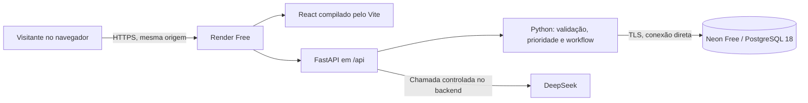

# SolicitaFlow

**Solicitações inteligentes, do pedido à resolução.**

**[Iniciar demonstração pública → https://solicitaflow.onrender.com](https://solicitaflow.onrender.com)**

[](https://github.com/waldirevora/solicitaflow/actions/workflows/verify.yml)

SolicitaFlow é um portfólio de **Engenharia de IA e automação corporativa B2B**:
mostra como organizar solicitações internas, identificar o departamento responsável
e acompanhar o atendimento até a resolução. A solução demonstra uma implementação
personalizável para empresas; não é um SaaS continuamente operado nem apresenta
resultados empresariais ou percentuais de economia não medidos.

O projeto evoluiu do AI Request Classifier no mesmo repositório, preservando seu
histórico. O desenvolvimento e a implantação pública estão concluídos neste marco.
O acompanhamento posterior é de manutenção e monitoramento operacional.

## Experimente sem login

Abra a demonstração e selecione **Experimentar o SolicitaFlow**. Não precisa de
senha, cadastro pessoal ou configuração técnica. Cada visitante utiliza uma sessão
anônima e um workspace fictício isolado. Use somente dados inventados.

1. Como **Colaborador**, envie o exemplo de TI e acompanhe a análise.
2. Como **Departamento**, abra o pedido encaminhado, assuma e registre andamento.
3. Simule a passagem do tempo para observar risco, cobrança e escalonamento de SLA.
4. Registre a resolução e volte ao colaborador para conferir a resposta.
5. Como **Central Operacional**, consulte histórico, exceções e relatórios.
6. Use o exemplo com dois assuntos para conhecer a revisão humana.

A sessão válida é retomada ao atualizar a página. Trocar personagens não exige
novas credenciais e só funciona no laboratório isolado. Contas corporativas locais
continuam protegidas por autenticação; esse acesso técnico não é exposto ao visitante.

**A análise DeepSeek é real e pode consumir créditos.** Empresa, personagens,
departamentos, atendimento, relógio, cobranças e resolução são demonstrativos.
Se houver falha, ambiguidade ou limite, o pedido fica salvo e segue para exceção,
sem classificação inventada. A IA interpreta; as regras validam; a pessoa esclarece
as exceções e o departamento confirma a resolução.

## Arquitetura publicada



| Tecnologia | Papel no fluxo |
| --- | --- |
| React / Vite | Interface responsiva, onboarding, personagens e temas; Vite gera o bundle de produção |
| FastAPI | API, sessões, autorização, orquestração e entrega dos arquivos estáticos |
| Python | Validação da resposta, matriz determinística de prioridade, roteamento, SLA e relatórios |
| DeepSeek | Sugestão estruturada de categoria, impacto, urgência e justificativa |
| PostgreSQL 18 / Neon Free | Persistência de solicitações, decisões, eventos, sessões e reservas de custo |
| Render Free | Um Web Service HTTPS para frontend e API, usando a porta fornecida pelo ambiente |

A chave de IA permanece no backend. O serviço público não utiliza Vite de
desenvolvimento, worker permanente ou scheduler externo. O banco público é novo e
separado dos bancos locais; não foi feita cópia automática dos dados do WSL.
Veja a [arquitetura técnica](docs/ARQUITETURA.md).

## Funcionalidades concluídas

- Landing comercial e educativa, demonstração sem senha e orientações por personagem.
- Cadastro persistente antes da tentativa de análise real.
- Categoria, impacto, urgência e justificativa sugeridos pela IA; prioridade calculada pela matriz Python.
- Encaminhamento automático apenas com destino validado; revisão humana de exceções.
- Portais do Colaborador, Departamento e Central Operacional com autorização por recurso.
- Responsável, andamento, primeira resposta, resolução, histórico e relatórios.
- SLA fictício, passagem do tempo, alertas internos e escalonamento sem mensagens externas.
- Sessões retomáveis, isolamento entre visitantes, expiração e retenção de temporários.
- Temas Claro, Escuro e Automático; primeiro acesso em Escuro, escolhas anteriores preservadas.
- Marca própria, favicons, layout responsivo, foco e navegação por teclado.
- Limites persistentes de IA, idempotência, concorrência restrita e tratamento seguro de interrupções.

O tutorial e a matriz funcionam sem chamar IA. Não há medição estatística publicada
de acurácia empresarial; os critérios e limites estão em
[Critérios de classificação](docs/CRITERIOS_CLASSIFICACAO.md).

## Limites ativos da demonstração

Configuração validada na publicação de 13/11/2026; não confundir com os defaults dos
exemplos de desenvolvimento local.

| Controle | Limite público |
| --- | --- |
| Tentativas de IA globais | 10 por dia UTC |
| Tentativas por laboratório | 2 durante a vida do workspace |
| Tentativas por rede | 5 por hora |
| Reserva global de tokens | 100.000 por dia |
| Orçamento conservador reservado | US$ 0,05 por dia |
| Chamadas simultâneas | 1 |
| Saída da IA / timeout | Até 400 tokens / 12 segundos |

Reservas são persistidas antes da chamada. Falhas não devolvem a reserva;
reenvios idempotentes e reinícios não repetem automaticamente chamadas pagas.
Consumo desconhecido exige conferência pelo operador. Quando um limite impede a
análise, o pedido permanece salvo e a interface informa o motivo.

Esse é um limite da integração, não um teto de faturamento de toda a conta DeepSeek.
Os planos Render/Neon utilizados são gratuitos; o uso de IA consome os créditos
existentes. Detalhes de sessões, criação de laboratórios, retenção e recuperação:
[Deploy e operação](docs/DEPLOY_PUBLICO.md) e [Segurança](docs/SEGURANCA.md).

## Disponibilidade do laboratório

O Render Free suspende o serviço após cerca de 15 minutos sem tráfego. O próximo
acesso inicia o serviço novamente e pode levar aproximadamente um minuto, com
variação conforme o provedor. O Neon também suspende o compute ocioso. Aguarde a
inicialização antes de concluir que houve falha; não reenvie pedidos repetidamente.

Não há SLA de produção ou monitoramento contínuo de prazos: o SLA fictício é
avaliado por eventos e pelo relógio do laboratório. **Não foi instalado gatilho
periódico do Neon, cron de keep-alive ou mecanismo para impedir a suspensão nativa.**
As franquias dos planos gratuitos podem limitar a disponibilidade.
[Limites oficiais do Render](https://render.com/docs/free) e
[Neon Free](https://neon.com/docs/introduction/plans).

## Desenvolvimento local

A cópia ativa está em `~/projects/ai-request-classifier`, no Ubuntu/WSL, com
Python 3.12, Node.js 24 e PostgreSQL 18 em `127.0.0.1:5432`. Caminhos e nomes dos
bancos mantêm os identificadores históricos para preservar compatibilidade.
O [Guia local](docs/GUIA.md) descreve dependências, variáveis e migrações.

Na instalação existente:

```bash
cd ~/projects/ai-request-classifier
backend/.venv/bin/python scripts/local_services.py start
backend/.venv/bin/python scripts/local_services.py status
```

Interface: http://localhost:5173 · Swagger local: http://localhost:8000/docs.
O controlador inicia somente backend, frontend e scheduler **local**, em loopback;
não instala, inicia ou encerra PostgreSQL. Para parar apenas a aplicação:

```bash
backend/.venv/bin/python scripts/local_services.py stop
```

Não sobrescreva `.env` ou `.env.test` existentes. Os templates locais deixam a IA
real desabilitada e usam roles distintas de aplicação e testes, sem superusuário
no runtime. O template de produção não deve ser aplicado à instalação local.

## Testes e evidências

```bash
cd ~/projects/ai-request-classifier
backend/.venv/bin/python scripts/local_services.py test
export PATH="$HOME/.local/opt/ai-request-classifier/node/bin:$PATH"
cd frontend
npm ci
npm test
npm run build
```

O preflight comprova o banco `ai_request_classifier_test`, sua role exclusiva e a
ausência de CONNECT no principal antes de qualquer limpeza. Verifica também o
snapshot do banco principal. Não execute pytest e QA de navegador em paralelo.
A suíte bloqueia ou simula o transporte da IA; não gera consumo pago.

Baseline funcional publicado: **104 testes backend, 32 frontend e build aprovados**.
O CI usa PostgreSQL 18 efêmero para migrações, compatibilidade, isolamento,
backup/restauração e duas jornadas de navegador de 17 passos com mocks. A URL
pública teve validação HTTPS desktop/mobile e nove estados axe sem violações.
Esses resultados têm escopo definido; não representam certificação integral de
acessibilidade, segurança ou qualidade estatística da IA.
Veja [evidências e encerramento](docs/ENCERRAMENTO.md) e os checks do PR atual.

## Versões e documentação

A tag histórica **`v2.6.1`** aponta para
[`8acaf71`](https://github.com/waldirevora/solicitaflow/commit/8acaf71ef36bc74de353a248ddd100318f21a67e)
(PR #14: identidade visual, FAQ e tema inicial). Não foi movida: não identifica o
deploy posterior. O baseline funcional público é
[`e894487`](https://github.com/waldirevora/solicitaflow/commit/e8944877d1d208a24cf0061ea5caa3c417f69d87),
após os PRs #16–#18. Commits posteriores de encerramento atualizam somente documentos;
com auto-deploy desabilitado, não mudam o SHA em execução no Render.

| Documento | Finalidade |
| --- | --- |
| [Guia local](docs/GUIA.md) | Preparar e executar desenvolvimento e testes isolados |
| [Arquitetura](docs/ARQUITETURA.md) | Componentes, dados e diferenças entre nuvem e ambiente local |
| [Segurança](docs/SEGURANCA.md) | Sessões, autorização, proteção contra abuso e limites |
| [Deploy e manutenção](docs/DEPLOY_PUBLICO.md) | Infraestrutura, migrações, backup, recuperação e atualização segura |
| [Encerramento](docs/ENCERRAMENTO.md) | Baseline, evidências e manutenção após a entrega |
| [Critérios de classificação](docs/CRITERIOS_CLASSIFICACAO.md) | Catálogos, matriz determinística e avaliação |
| [Histórico pré-deploy](docs/PRE_DEPLOY.md) | Auditoria anterior, decisões e preservação dos arquivos legados |
| [V2.6.1 histórica](docs/V2_6_1.md) | Entrega visual associada à tag preservada |

Nunca versione `.env`, credenciais, dumps, backups, logs sensíveis ou artefatos
privados. O contato comercial só é exibido quando `SF_CONTACT_URL` está configurado
com um canal profissional confirmado; nenhum endereço é presumido.
