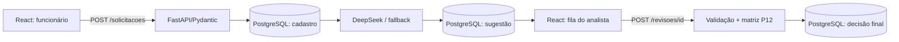

# AI Request Classifier

**Triagem de solicitações internas com classificação automática por IA e revisão humana.**

> **Estado:** P01–P13 concluídas. **P14 funcionalmente validada no ambiente local**: React renderizando após ajuste de importação, fila e revisão humana testadas, 41 testes Python aprovados e build Vite concluído. Faltam a revisão do staging e o commit/push da P14. P15 (avaliação, métricas, segurança e documentação final) pendente. Repositório privado até decisão expressa de publicação.

## Problema empresarial

Solicitações chegam sem classificação padronizada, gerando triagem manual repetitiva. A solução padroniza o cadastro, solicita à DeepSeek sugestões de categoria, impacto, urgência e justificativa, calcula a prioridade pela política P12 e permite que um analista **aceite ou corrija** o resultado. Classificar não significa resolver o chamado.

## Fluxo de negócio e arquitetura



O cadastro é confirmado antes da chamada à IA. Falhas da IA não apagam solicitações; elas permanecem disponíveis para correção manual. O React **não recebe nem utiliza a chave DeepSeek**: a chamada ao modelo acontece exclusivamente no backend Python.

## Stack e estrutura

- Backend: Python 3.14, FastAPI, Pydantic, PostgreSQL 18 (Windows `127.0.0.1:5433`), psycopg, pytest.
- IA: API DeepSeek `deepseek-flash` via HTTPS; classificação automática após o cadastro.
- Frontend: React 19 + Vite 6, CSS, Fetch API. Ambiente de desenvolvimento local.

```text
backend/
  app/
    main.py                  # instancia FastAPI e registra as rotas
    database.py              # conexão PostgreSQL e carregamento .env
    classificacao.py         # enums e matriz de prioridade P12
    ia.py                    # chamada HTTP DeepSeek P13
    triagem.py               # persistência de sugestões P13/P14
    schemas.py               # entrada de solicitações P11
    schemas_revisao.py       # contrato de revisão P14
    routes/
      solicitacoes.py        # CRUD e acionamento automático P13
      revisoes.py            # fila + decisões finais P14
  sql/
    001_create_solicitacoes.sql
    002_add_classificacao_ia.sql
    003_add_revisao_humana.sql
  evaluation/casos_referencia.json
  tests/                     # testes API, IA, regras, triagem e revisão
  .env.example               # configuração de exemplo sem chave real
  requirements.txt
  requirements-dev.txt
frontend/
  package.json
  vite.config.js             # proxy /api para FastAPI local
  src/
    api.js                   # cliente HTTP da nossa API
    App.jsx                  # formulário, fila e revisão
    main.jsx
    styles.css
docs/
  ARQUITETURA.md
  CRITERIOS_CLASSIFICACAO.md
  PLANO_DE_ESTUDOS_E_DICAS.md
```

## Instruções locais (Windows PowerShell)

Pré-requisitos: PostgreSQL de desenvolvimento e teste já preparados até a migração 002; Python do backend na `.venv`; Node.js instalado para o Vite. **Não recriar bancos existentes e não copiar credenciais para o Git.**

### 1. Migrar esquema P14 (uma vez por banco)

Na **raiz** do projeto, com `psql` disponível no PATH:

```powershell
cd D:\Projects\ai-request-classifier
$env:Path += ";C:\Program Files\PostgreSQL\18\bin"
psql -U postgres -h 127.0.0.1 -p 5433 -d ai_request_classifier -v ON_ERROR_STOP=1 -f .\backend\sql\003_add_revisao_humana.sql
psql -U postgres -h 127.0.0.1 -p 5433 -d ai_request_classifier_test -v ON_ERROR_STOP=1 -f .\backend\sql\003_add_revisao_humana.sql
```

Migração incremental: acrescenta campos finais e a decisão do analista; não apaga dados já existentes. O segundo banco é reservado aos testes, que usam `TRUNCATE`: **não armazene dados importantes nele.**

### 2. FastAPI

Em um terminal:

```powershell
cd D:\Projects\ai-request-classifier\backend
.\.venv\Scripts\python.exe -m uvicorn app.main:app --reload
```

- Swagger: http://127.0.0.1:8000/docs
- Health: http://127.0.0.1:8000/health

Em `backend/.env`, o uso da DeepSeek depende de `AI_ENABLED=true`, `DEEPSEEK_API_KEY` válida e `AI_MODEL=deepseek-flash`. Para rodar sem custos de IA, use `AI_ENABLED=false`: o analista poderá classificar manualmente solicitações pendentes.

### 3. React + Vite

Em **outro terminal**:

```powershell
cd D:\Projects\ai-request-classifier\frontend
npm install
npm run dev
```

Abra http://127.0.0.1:5173/. O Vite encaminha chamadas `/api/*` para `http://127.0.0.1:8000/*` durante o desenvolvimento. Isso evita configurar CORS apenas para o ambiente local. **Build P14 validado no Windows:** Vite 6.4.4, 25 módulos transformados, compilação em 1,39 s. A tela vazia inicial foi corrigida adicionando `React` à importação de `frontend/src/App.jsx`. Versionar `frontend/package-lock.json`, mas jamais `frontend/node_modules/` ou `frontend/dist/`.

### 4. Testes

Com o PostgreSQL **de testes** acessível, em terminal separado:

```powershell
cd D:\Projects\ai-request-classifier\backend
$env:AI_ENABLED = "false"
.\.venv\Scripts\python.exe -m pytest -q
Remove-Item Env:\AI_ENABLED -ErrorAction SilentlyContinue
```

Os testes P14 simulam situações com e sem sugestão: aceitar, corrigir, fallback manual, validação de entrada, impedir revisão repetida, fila e histórico. Não utilizam créditos da DeepSeek. **Evidência registrada na P14: 41 testes aprovados em 5,30 s no Windows** (`AI_ENABLED=false`).

## Contrato HTTP

| Método | Caminho | Função |
|---|---|---|
| GET | `/health` | Estado básico da API |
| POST | `/solicitacoes` | Cadastro + tentativa automática de IA |
| GET | `/solicitacoes` | Lista com sugestões e decisões finais |
| GET | `/solicitacoes/{id}` | Detalhe |
| PUT | `/solicitacoes/{id}` | Atualização de título/descrição, sem reclassificação |
| DELETE | `/solicitacoes/{id}` | Exclusão |
| GET | `/revisoes/pendentes` | Fila de análise (`aguardando_revisao`, `classificacao_falhou`, `pendente_classificacao`) |
| GET | `/revisoes/concluidas` | Histórico de revisões finalizadas |
| POST | `/revisoes/{id}` | Aceita sugestão ou registra correção manual |

Aceite:

```json
{"decisao":"aceitar"}
```

Correção:

```json
{
  "decisao": "corrigir",
  "categoria": "acessos_permissoes",
  "impacto": "individual",
  "urgencia": "alta",
  "observacao": "Bloqueio de permissão para uma pessoa."
}
```

Em ambos os casos o backend calcula a prioridade pela matriz P12 e persiste os campos `*_final` e `decisao_revisao`, preservando os campos originais `*_sugerida`. Uma revisão concluída não pode ser repetida (`409`).

## Limitações e segurança

Este MVP **não possui login, autorização por perfil, identificação auditável de quem revisou nem proteção de acesso remoto**. **Use somente localhost e dados fictícios; não exponha a API ou interface à internet.** As credenciais ficam no `.env` ignorado pelo Git. Antes de produção/publicação serão necessários revisão de segurança, controles de acesso, política de dados, auditoria do Git, licença e medições de custo/latência com amostra representativa.

## Roadmap

- **P01–P13:** backend, PostgreSQL, matriz P12 e IA automática — concluídos.
- **P14:** frontend React, fila e revisão humana — integração e testes locais validados; resta revisar Git, fazer commit e push.
- **P15:** avaliação com casos de referência, testes ponta a ponta, métricas, segurança e documentação comercial; publicação somente com autorização expressa.

Detalhes: [Arquitetura](docs/ARQUITETURA.md), [Critérios de classificação](docs/CRITERIOS_CLASSIFICACAO.md) e [Plano de estudos](docs/PLANO_DE_ESTUDOS_E_DICAS.md).
