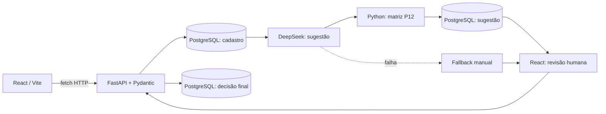

# AI Request Classifier

**Triagem empresarial assistida por inteligência artificial, com prioridade padronizada e revisão humana.**

> **Estado:** MVP local funcional; P01–P14 concluídas. Na P15, **46 testes Python aprovados**, compilação React validada, `npm audit` sem alertas reportados e avaliação real da DeepSeek em 10 casos fictícios com **60% de acerto completo** (10/10 chamadas bem-sucedidas). Varredura Gitleaks no histórico: **16 commits analisados, nenhum segredo detectado**. Licença MIT definida. **P15 aguarda revisão do staging, commit/push e autorização para publicar o repositório. A aplicação não é adequada para hospedagem pública sem controles adicionais.**

## Qual problema de negócio resolve?

Empresas recebem solicitações internas com qualidade variável e diferentes interpretações de urgência. A triagem exclusivamente manual gera trabalho repetitivo e decisões pouco padronizadas. O AI Request Classifier demonstra como automatizar **uma sugestão de classificação** e manter o analista responsável pela decisão final.

O MVP foi desenvolvido como projeto prático de Engenharia de Software e Engenharia de IA. Não automatiza a resolução de chamados.

## O que o produto faz?

1. Funcionário registra título e descrição no React.
2. FastAPI/Pydantic valida os dados e confirma o cadastro no PostgreSQL.
3. Backend chama automaticamente a DeepSeek (`deepseek-flash`) para sugerir categoria, impacto, urgência e justificativa.
4. Python aplica uma **matriz determinística** para calcular prioridade.
5. Analista aceita ou corrige a sugestão no React; o backend salva a decisão humana preservando a sugestão original.
6. Em falha da IA, o cadastro permanece no banco e pode ser classificado manualmente.

## Arquitetura



**Por que esta arquitetura?** Frontend e backend separados simplificam o contrato HTTP; PostgreSQL fornece persistência; regras de prioridade ficam auditáveis no Python; a IA gera sugestões sem assumir a decisão final. Confirmar o `INSERT` antes da chamada externa reduz a perda de registros em caso de falha de rede.

### Tecnologias

- **Backend:** Python 3.14, FastAPI, Pydantic, psycopg, PostgreSQL 18 e pytest.
- **IA:** DeepSeek `deepseek-flash` por HTTPS, com validação JSON, timeout e tratamento de falhas.
- **Frontend:** React 19, Vite 6 e Fetch API.
- **Qualidade:** suíte de API/integração, testes de regras e revisão, avaliação baseada nos dez casos P12.

## Estrutura principal

```text
backend/
  app/
    main.py
    database.py
    schemas.py
    classificacao.py
    ia.py
    triagem.py
    schemas_revisao.py
    routes/solicitacoes.py
    routes/revisoes.py
  sql/
    001_create_solicitacoes.sql
    002_add_classificacao_ia.sql
    003_add_revisao_humana.sql
  evaluation/
    casos_referencia.json
    avaliar_ia.py
  tests/
    test_api.py
    test_classificacao.py
    test_ia.py
    test_triagem.py
    test_revisoes.py
    test_avaliacao.py
  .env.example
  requirements.txt
  requirements-dev.txt
frontend/
  src/App.jsx
  src/api.js
  src/main.jsx
  src/styles.css
  package.json
  package-lock.json
  vite.config.js
docs/
  GUIA.md
  ARQUITETURA.md
  CRITERIOS_CLASSIFICACAO.md
  PLANO_DE_ESTUDOS_E_DICAS.md
  RELATORIO_AVALIACAO.md
```

## Instruções de execução local

**Pré-requisitos:** Python compatível (ambiente de desenvolvimento: 3.14.7), PostgreSQL local 18, Node.js e dependências já instaladas. O banco principal é `ai_request_classifier` e o banco destrutivo de testes é `ai_request_classifier_test`. No ambiente documentado, o PostgreSQL Windows usa `127.0.0.1:5433`; outra instância Docker usa 5432 e não deve ser confundida.

Os scripts de banco `001`, `002` e `003` devem estar aplicados antes de iniciar a API. Consulte o [guia oficial](docs/GUIA.md) para preparação, validação e precauções.

**FastAPI**, terminal 1:

```powershell
cd D:\Projects\ai-request-classifier\backend
.\.venv\Scripts\python.exe -m uvicorn app.main:app --reload
```

**React**, terminal 2:

```powershell
cd D:\Projects\ai-request-classifier\frontend
npm ci
npm run dev
```

Acesse [React](http://127.0.0.1:5173/) e [Swagger](http://127.0.0.1:8000/docs). Vite encaminha `/api` ao FastAPI local.

A chave da DeepSeek é mantida exclusivamente em `backend/.env`, que não deve ser versionado. `AI_ENABLED=false` evita chamadas ao provedor no fluxo normal de cadastro e permite classificação manual.

## Endpoints principais

| Método | Caminho | Operação |
|---|---|---|
| POST | `/solicitacoes` | Cadastro + tentativa automática de IA |
| GET | `/solicitacoes` | Listagem |
| GET | `/solicitacoes/{id}` | Detalhe |
| PUT / DELETE | `/solicitacoes/{id}` | Atualização / remoção |
| GET | `/revisoes/pendentes` | Fila de revisão |
| GET | `/revisoes/concluidas` | Histórico de decisões |
| POST | `/revisoes/{id}` | Aceite ou correção humana |
| GET | `/health` | Estado básico da API |

Estados: `pendente_classificacao`, `aguardando_revisao`, `classificacao_falhou`, `revisada`. A prioridade é calculada no backend, tanto para a sugestão quanto para a decisão final.

## Testes e evidências

**Evidências locais:** P14 — 41 testes Python em 5,30 s e build Vite 6.4.4 em 1,39 s. P15 — **46 testes Python aprovados em 5,56 s**, com confirmação posterior de que os testes continuam funcionando; `pip check` sem requisitos quebrados; `npm ci` e `npm run build` aprovados (Vite 6.4.4, 25 módulos, 1,16 s); `npm audit` reportou **0 vulnerabilidades conhecidas**. Essas observações não são resultados de produção.

Para executar a suíte atualizada, na pasta `backend`:

```powershell
$env:AI_ENABLED = "false"
.\.venv\Scripts\python.exe -m pytest -q
Remove-Item Env:\AI_ENABLED -ErrorAction SilentlyContinue
```

Para compilar React, na pasta `frontend`:

```powershell
npm ci
npm run build
```

### Avaliação da IA — P15

O conjunto P12 contém **dez casos fictícios com resultados esperados**. A avaliação compara categoria, impacto, urgência e prioridade e apresenta tokens e latência. A prévia é offline:

```powershell
cd D:\Projects\ai-request-classifier\backend
.\.venv\Scripts\python.exe evaluation\avaliar_ia.py
```

**Somente o comando explícito abaixo fará dez chamadas reais e poderá ter custo:**

```powershell
.\.venv\Scripts\python.exe evaluation\avaliar_ia.py --live
```

O script não escreve no PostgreSQL. **Resultado medido na rodada P15 de 10 casos:** 10/10 chamadas bem-sucedidas; categoria 90%, impacto 90%, urgência 70%, prioridade 90% e **acerto completo 60% (6/10)**. Foram registrados **3.289 tokens de entrada e 551 de saída**, com latência média de **1.215 ms** (mín. 1.039, máx. 1.609 ms). Casos divergentes: **C03, C05, C08 e C09**. Detalhes em [Relatório de avaliação](docs/RELATORIO_AVALIACAO.md).

Esses resultados representam **somente dez exemplos fictícios** e não equivalem à qualidade em produção. O custo monetário não foi calculado, pois depende de preços e modalidades de tokens ainda não conferidos. A observação da P13 não foi somada a essa rodada.

## Segurança e limites do MVP

- Sem login, autorização por perfil ou identificação verificável de revisores: **manter restrito a localhost**, sem túnel externo ou dados reais.
- Dados enviados ao modelo externo devem ser fictícios nesta demonstração.
- O prompt orienta a tratar descrição como dado não confiável; isso não prova resistência integral a **prompt injection**.
- Revisões usam transação e bloqueio `SELECT ... FOR UPDATE`; conflitos recebem `409`.
- `.env` e chaves não entram no Git. O histórico foi examinado com Gitleaks (`--all`, 16 commits, aproximadamente 275 KB, nenhum vazamento identificado); isso não dispensa revisão humana do staging e dos arquivos publicados.
- O custo efetivo depende de tarifas e tipos de tokens vigentes, não só do total bruto de tokens.
- Não foram executados testes de carga ou homologação de produção.

## Licença e conclusão planejada

O código deste repositório é disponibilizado sob a **licença MIT**. Veja [LICENSE](LICENSE). Bibliotecas, ferramentas e serviços externos permanecem sujeitos às próprias licenças e condições.

**P01–P14 concluídas e P15 em fechamento.** Avaliação exploratória, testes, build, auditoria npm e varredura de segredos foram executados. O uso local foi validado pelo desenvolvedor; ainda faltam revisão do staging, commit/push final e autorização explícita para tornar o **código** público. Publicar o repositório não significa hospedar uma aplicação segura para usuários externos.

Documentos: [Guia](docs/GUIA.md) · [Arquitetura](docs/ARQUITETURA.md) · [Critérios](docs/CRITERIOS_CLASSIFICACAO.md) · [Relatório](docs/RELATORIO_AVALIACAO.md) · [Plano](docs/PLANO_DE_ESTUDOS_E_DICAS.md).
