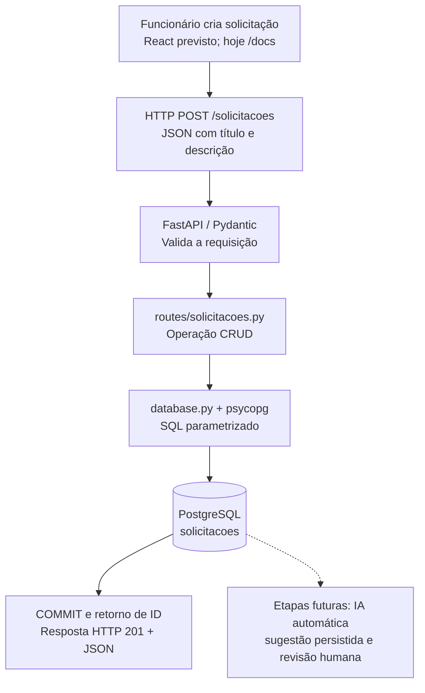

# Arquitetura técnica | AI Request Classifier

**Estado documentado:** P11 — integração FastAPI–PostgreSQL implementada segundo o trabalho apresentado, com testes informados como funcionais; persistência após reiniciar o Uvicorn e revisão final do commit ainda aguardam confirmação específica. Este documento descreve a arquitetura da etapa P11, não um sistema completo de classificação por IA.

## 1. Problema e objetivo

O produto busca reduzir o trabalho repetitivo de triagem de solicitações internas e padronizar o registro das decisões. O funcionário cadastra uma solicitação; futuramente o backend acionará uma IA automaticamente para sugerir categoria, prioridade e justificativa, registrará a sugestão e permitirá que o analista aceite ou corrija. **A sugestão não é uma resolução automática do chamado.**

## 2. Fluxo de negócio e execução técnica



**Situação atual:** cliente HTTP/Swagger → FastAPI → psycopg → PostgreSQL. O React e a etapa de IA estão planejados e não participam desse fluxo ainda.

## 3. Responsabilidades dos módulos

| Arquivo | Responsabilidade |
|---|---|
| `backend/app/main.py` | Criação da aplicação FastAPI, `/health` e registro do router |
| `backend/app/schemas.py` | Modelos e validação de título e descrição via Pydantic |
| `backend/app/database.py` | Configuração e abertura de conexões PostgreSQL com `psycopg` |
| `backend/app/routes/solicitacoes.py` | Rotas HTTP, instruções SQL e respostas 404 quando necessário |
| `backend/sql/001_create_solicitacoes.sql` | Definição versionada da tabela e de suas restrições |
| `backend/tests/test_api.py` | Testes da API com `pytest` e `TestClient` e isolamento do banco |
| `backend/.env.example` | Exemplo de configuração sem senha real |

A implementação anterior com `storage.py` e lista em memória está sendo substituída pela persistência PostgreSQL nesta etapa.

## 4. Modelo de dados

Banco de desenvolvimento: `ai_request_classifier`.

Tabela: `public.solicitacoes`.

| Coluna | Tipo PostgreSQL | Regras |
|---|---|---|
| `id` | `BIGINT` | `GENERATED ALWAYS AS IDENTITY`, `PRIMARY KEY` |
| `titulo` | `VARCHAR(120)` | `NOT NULL`, comprimento de 3 a 120 após `btrim` |
| `descricao` | `TEXT` | `NOT NULL`, comprimento de 10 a 2000 após `btrim` |
| `status` | `VARCHAR(40)` | `NOT NULL`, padrão `pendente_classificacao` |
| `criado_em` | `TIMESTAMPTZ` | `NOT NULL`, padrão `CURRENT_TIMESTAMP` |

O PostgreSQL atribui os IDs; **IDs são únicos, mas não necessariamente consecutivos**. O schema está em `backend/sql/001_create_solicitacoes.sql`.

A tabela ainda não contém campos de categoria, prioridade, justificativa ou avaliação humana: essa modelagem será introduzida nas próximas etapas.

## 5. Contrato HTTP

| Método | Rota | Resultado principal |
|---|---|---|
| `GET` | `/health` | `200` + `{"status":"ok"}` |
| `POST` | `/solicitacoes` | `201` + registro criado |
| `GET` | `/solicitacoes` | `200` + lista ordenada por ID |
| `GET` | `/solicitacoes/{id_solicitacao}` | `200` + registro, ou `404` |
| `PUT` | `/solicitacoes/{id_solicitacao}` | `200` + registro atualizado, ou `404` |
| `DELETE` | `/solicitacoes/{id_solicitacao}` | `204` sem corpo, ou `404` |

Corpos inválidos e parâmetros incompatíveis com os tipos esperados geram `422`. `PUT` atualiza `titulo` e `descricao`, mantendo os demais campos do registro.

### Exemplo de entrada

```json
{
  "titulo": "Computador não liga",
  "descricao": "O equipamento não inicia desde hoje."
}
```

O retorno do cadastro inclui `id`, `titulo`, `descricao`, `status` e `criado_em`.

## 6. Integração e transações

- `python-dotenv` carrega a configuração local de `backend/.env`.
- `psycopg.connect()` abre a conexão com host, porta, base e usuário configurados.
- `dict_row` permite obter linhas de resultado como dicionários Python.
- Os valores recebidos nos endpoints são vinculados aos placeholders `%s` em consultas parametrizadas, sem montagem de SQL por concatenação.
- `with conectar() as conn` confirma a transação quando o bloco termina normalmente; em caso de exceção, desfaz a transação e fecha a conexão.
- O banco valida sua integridade com `PRIMARY KEY`, `NOT NULL`, `DEFAULT` e `CHECK`, independentemente de Pydantic.

O uso de uma conexão por operação atende ao propósito didático atual, mas **não é uma arquitetura de alto desempenho validada para produção**. Pool de conexões, tratamento de indisponibilidade e observabilidade serão avaliados conforme o projeto evoluir.

## 7. Configuração local e credenciais

Ambiente do desenvolvedor: PostgreSQL 18.6 no Windows, acessível em `127.0.0.1:5433`. Há também outra instância no Docker acessível pela porta `5432`; **não são a mesma instância**.

Variáveis esperadas:

```dotenv
PGHOST=127.0.0.1
PGPORT=5433
PGDATABASE=ai_request_classifier
PGUSER=postgres
PGPASSWORD=SUA_SENHA_LOCAL
```

O arquivo `backend/.env` deve ficar fora do Git. Apenas `backend/.env.example`, sem segredo real, pode ser versionado. O usuário administrador `postgres` é aceitável apenas no laboratório; uma implantação precisará de usuário restrito, permissões mínimas e configuração segura.

## 8. Testes e isolamento

Banco de desenvolvimento: `ai_request_classifier`.

Banco exclusivo de testes: `ai_request_classifier_test`.

A suíte automatizada é executada a partir de `backend`:

```powershell
.\.venv\Scripts\python.exe -m pytest -q
```

Os testes utilizam `TestClient` e uma fixture que seleciona o banco de testes e executa `TRUNCATE TABLE solicitacoes RESTART IDENTITY` antes de cada teste. O código deve conferir o nome do banco conectado **antes de executar essa limpeza destrutiva**.

As verificações cobrem saúde, cadastro, lista, detalhe, erros `404` e `422`, atualização, exclusão e não reutilização de identificador após exclusão dentro de um teste. O desenvolvedor informou que os testes da P11 funcionaram; o output exato não foi anexado a esta revisão documental.

**Validação manual final ainda pendente de confirmação explícita:** cadastrar via API, encerrar e reiniciar o Uvicorn, consultar o mesmo registro e conferir que ele permanece no PostgreSQL.

## 9. Limites atuais e evolução

**Já implementado na etapa P11:** backend REST modular, validação de entrada, esquema PostgreSQL, conexão por driver, CRUD com SQL parametrizado e suíte de testes.

**Ainda não implementado:** autenticação/autorização, React, LLM, classificação automática, persistência de sugestões, workflow de revisão humana, logs de auditoria e políticas de retenção.

Antes de liberar a aplicação para uso real serão necessários testes adicionais, usuário de banco com privilégio mínimo, tratamento de falhas externas e revisão de privacidade. Custos e latência de produção ainda não foram medidos.

### Próximas entregas

1. Concluir validação da P11 e auditoria do repositório antes de eventual publicação pública.
2. Modelar categorias, prioridades e exemplos de avaliação.
3. Integrar IA por API: acionamento automático após cadastro, validação do retorno e tolerância a falhas.
4. Persistir sugestões e decisões humanas com rastreabilidade.
5. Desenvolver frontend React e pipeline de revisão.

A publicação do GitHub permanece condicionada à auditoria de segurança e à decisão explícita do desenvolvedor.
