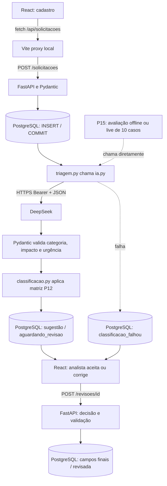

# Arquitetura | AI Request Classifier

**Estado:** MVP funcional local até P14; P15 em validação. Não está preparado para implantação pública.

## Negócio

Padronizar a triagem de solicitações internas: cadastro, sugestão de IA, cálculo determinístico da prioridade e decisão humana. **Classificar não é resolver o chamado.**

## Fluxo ponta a ponta

## Responsabilidades

| Arquivo | Papel |
|---|---|
| `frontend/src/App.jsx` | UI de cadastro, fila e revisão humana |
| `frontend/src/api.js` | Chamadas `fetch` à FastAPI |
| `frontend/vite.config.js` | Proxy local `/api` -> porta 8000 |
| `backend/app/main.py` | Inicialização e inclusão dos routers |
| `backend/app/routes/solicitacoes.py` | CRUD e acionamento automático da triagem |
| `backend/app/schemas.py` | Validação do cadastro |
| `backend/app/database.py` | Conexão PostgreSQL e carregamento `.env` |
| `backend/app/triagem.py` | Chamada da IA, persistência e fallback |
| `backend/app/ia.py` | HTTPS DeepSeek, instruções, JSON e validação de resposta |
| `backend/app/classificacao.py` | Categoria, impacto, urgência e prioridade pela matriz |
| `backend/app/schemas_revisao.py` | Contrato Pydantic para decisão humana |
| `backend/app/routes/revisoes.py` | Fila, histórico, aceite/correção com transação |
| `backend/evaluation/avaliar_ia.py` | P15: avaliação pontual direta, sem escrever no banco |
| `backend/tests/test_avaliacao.py` | P15: testes offline do cálculo de métricas |

## Dados e estados

- `001_create_solicitacoes.sql`: `id`, título, descrição, status e data de criação.
- `002_add_classificacao_ia.sql`: categoria, impacto, urgência, prioridade e justificativa sugeridos; modelo, tokens, latência e hora da classificação.
- `003_add_revisao_humana.sql`: categoria, impacto, urgência e prioridade finais; decisão, observação e data da revisão.
- Estados: `pendente_classificacao` (sem sugestão), `aguardando_revisao` (IA respondeu), `classificacao_falhou` (API falhou), `revisada` (decisão final).

O cadastro é confirmado **antes** de chamar a DeepSeek: falhas de rede não apagam o registro. O analista pode corrigir manualmente quando IA falha. Aceite exige sugestão existente; revisão duplicada devolve `409` e a operação usa `SELECT ... FOR UPDATE`.

## Contrato HTTP principal

- `POST /solicitacoes`: cadastro, tentativa automática de IA, resposta `201`.
- `GET /solicitacoes` e `GET /solicitacoes/{id}`: consulta.
- `PUT /solicitacoes/{id}` / `DELETE /solicitacoes/{id}`: CRUD existente.
- `GET /revisoes/pendentes`: fila; `GET /revisoes/concluidas`: histórico.
- `POST /revisoes/{id}`: `{"decisao":"aceitar"}` ou `{"decisao":"corrigir", "categoria":"...", "impacto":"...", "urgencia":"...", "observacao":"..."}`.
- O backend recalcula prioridade final mesmo quando a interface exibe valores previstos.

## Avaliação e qualidade (P15)

`avaliar_ia.py` lê o conjunto P12 e, **somente com `--live`**, chama `app.ia.classificar_solicitacao` dez vezes (ou menos, com `--limit`). Compara categoria, impacto, urgência e prioridade esperadas com as sugestões. Contabiliza erros como falhas, mostra tokens e latência e não grava dados no PostgreSQL. Taxas com dez casos são exploratórias, não métricas de produção.

Testes P14: 41 passaram no Windows. P15: **46 testes Python aprovados**, `pip check` sem conflitos identificados e frontend compilado com Vite 6.4.4 (`npm ci` e `npm run build` aprovados); `npm audit` não reportou vulnerabilidades conhecidas. A avaliação da DeepSeek executou **10/10 chamadas com sucesso**: categoria 90%, impacto 90%, urgência 70%, prioridade 90%, acerto completo 60%, 3.289 tokens de entrada, 551 de saída e latência média de 1.215 ms. Os resultados se limitam a dez casos fictícios; custo monetário não foi medido. Banco automatizado `ai_request_classifier_test` é separado e usa `TRUNCATE` destrutivo somente nele.

## Limitações e segurança

Sem autenticação, autorização, identificação auditável do revisor, limites de tráfego e privacidade operacional completos; não expor a aplicação fora de localhost. A chamada ao modelo usa texto como dado não confiável e há instruções básicas para ignorar comandos embutidos, mas isso **não equivale a proteção completa contra prompt injection**. Na P15 testar exemplos adversariais e manter revisão humana. GitHub público significa publicação do **código**, não habilitação de um servidor de produção.

O `.env` nunca deve ser versionado; `frontend/node_modules/`, `frontend/dist/` e o prompt privado não entram no Git. Auditoria local pré-publicação: `backend/.env` fora do Git; `frontend/node_modules` e `frontend/dist` ignorados; Gitleaks examinou 16 commits e aproximadamente 275 KB, sem achar segredos conforme suas regras. A licença MIT foi escolhida; falta revisão do staging e commit/push. **A visibilidade do repositório só muda com autorização explícita do desenvolvedor.**
