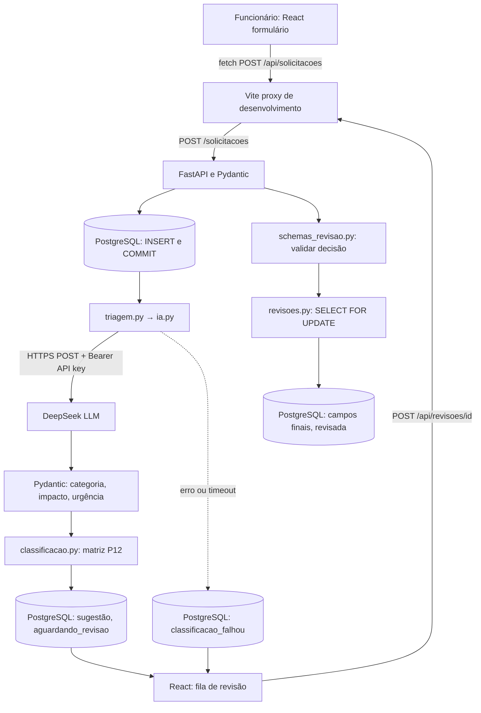

# Arquitetura | AI Request Classifier

**Referência:** P13 concluída; **P14 validada funcionalmente em localhost** (revisão humana manual, 41 testes Python aprovados, build React/Vite aprovado). Aguarda revisão de staging, commit e push. GitHub privado durante o desenvolvimento.

## Objetivo empresarial

Padronizar solicitações internas; usar DeepSeek para **sugerir**, e um analista para **aceitar ou corrigir** a triagem. A classificação determina categoria e prioridade; não resolve o chamado.

## Diagrama ponta a ponta

Em desenvolvimento, o navegador chama `/api` na origem do Vite (`5173`), e o Vite encaminha para a FastAPI (`8000`). Isso é **proxy reverso local**, não uma implantação de produção. O frontend **nunca chama a DeepSeek** nem precisa da chave dela.

## Responsabilidades dos módulos

| Arquivo | Responsabilidade |
|---|---|
| `frontend/src/App.jsx` | Formulário, estado React, seleção e decisão do analista |
| `frontend/src/api.js` | `fetch` para FastAPI, JSON e tratamento de erros HTTP |
| `frontend/vite.config.js` | Proxy `/api` → FastAPI local |
| `backend/app/main.py` | Cria FastAPI e inclui routers `/solicitacoes` e `/revisoes` |
| `backend/app/routes/solicitacoes.py` | CRUD, insere e aciona `processar_solicitacao()` P13 |
| `backend/app/schemas.py` | Valida entrada do cadastro |
| `backend/app/database.py` | Conexão psycopg e `.env` local |
| `backend/app/ia.py` | Chamada HTTPS DeepSeek, JSON estruturado e validação |
| `backend/app/triagem.py` | Orquestra IA, fallback e projeção dos campos retornados |
| `backend/app/classificacao.py` | Taxonomia/`Enum` e matriz determinística de prioridade |
| `backend/app/schemas_revisao.py` | Contrato de aceite/correção com Pydantic |
| `backend/app/routes/revisoes.py` | Fila, histórico, transação de revisão e cálculo final |
| `backend/sql/003_add_revisao_humana.sql` | Novas colunas de resultado final e metadados da decisão |
| `backend/tests/test_revisoes.py` | Testes integrados no PostgreSQL isolado, sem LLM real |

## Fluxo da revisão humana

**Aceitar:** somente quando `status=aguardando_revisao`, com sugestão completa. O backend copia categoria, impacto e urgência sugeridos e **recalcula** a prioridade pela matriz P12.

**Corrigir:** permitido em `aguardando_revisao`, `classificacao_falhou` ou `pendente_classificacao`. O analista informa categoria, impacto, urgência e motivo com pelo menos 10 caracteres. O backend valida os `Enum` e calcula a prioridade.

**Persistir:** dentro de uma transação SQL, `SELECT ... FOR UPDATE` bloqueia o registro enquanto a decisão é gravada. A segunda tentativa de revisar um registro já finalizado recebe `409 Conflict`, evitando sobrescrita silenciosa.

**Resposta:** `status=revisada`, `categoria_final`, `impacto_final`, `urgencia_final`, `prioridade_final`, `decisao_revisao`, `observacao_revisao`, `revisado_em`. As sugestões originais da IA continuam armazenadas para comparação.

## Evolução do esquema

`001_create_solicitacoes.sql`: id, título, descrição, status e criação.

`002_add_classificacao_ia.sql`: sugestões, justificativa, modelo, tokens, latência e timestamp de classificação.

`003_add_revisao_humana.sql`: `categoria_final VARCHAR(32)`, `impacto_final VARCHAR(16)`, `urgencia_final VARCHAR(16)`, `prioridade_final VARCHAR(8)`, `decisao_revisao VARCHAR(16)`, `observacao_revisao VARCHAR(500)` e `revisado_em TIMESTAMPTZ`. Todas novas colunas são inicialmente nulas para preservar registros existentes.

Migração 003 incremental e não destrutiva. Aplicar **primeiro** no PostgreSQL Windows `127.0.0.1:5433`, nos bancos `ai_request_classifier` e `ai_request_classifier_test`, antes de iniciar o novo backend. Não confundir com a instância Docker na porta 5432.

## Estados de negócio

| Estado | Significado | Ação na P14 |
|---|---|---|
| `pendente_classificacao` | IA desabilitada / ainda não processado | Correção/classificação manual |
| `aguardando_revisao` | IA gerou sugestão | Aceitar ou corrigir |
| `classificacao_falhou` | Falha da LLM após cadastro | Correção/classificação manual |
| `revisada` | Decisão humana registrada | Visualizar no histórico; não revisar novamente |

## Contratos de API da revisão

`GET /revisoes/pendentes` e `GET /revisoes/concluidas` devolvem listas; `POST /revisoes/{id}` recebe `{"decisao":"aceitar"}` ou `{"decisao":"corrigir","categoria":"suporte_ti","impacto":"equipe","urgencia":"alta","observacao":"Justificativa válida..."}`.

`404`: ID inexistente. `409`: revisão duplicada, sugestão ausente para aceite ou estado incompatível. `422`: corpo ou valores inválidos. O servidor é a fonte de verdade, mesmo quando o React verifica os campos antes de enviar.

## Testes e segurança

A suíte de integração usa banco exclusivo `ai_request_classifier_test`, verificado **antes** de `TRUNCATE TABLE ... RESTART IDENTITY`. A IA permanece desativada/simulada para não consumir créditos. Validar também manualmente: cadastrar, revisar, atualizar a página e confirmar persistência do resultado.

**Limitações conscientes do MVP:** sem autenticação, identificação do analista, política de acesso, paginação, reprocessamento automático, fila assíncrona, SLA ou tratamento de concorrência de alterações em título/descrição. O `FOR UPDATE` cobre concorrência entre revisões, não todas as operações CRUD. **Não expor à internet.** P15 tratará avaliação, auditoria e recomendações de segurança; não alegar segurança de produção.

## Evidências e ressalvas da P14 (15/10/2026)

- `pytest -q` com `AI_ENABLED=false`: **41 passed in 5.30s**, utilizando banco isolado de testes.
- `npm run build`: **25 módulos transformados**, Vite 6.4.4, **built in 1.39s**.
- Tela vazia inicial resolvida com importação explícita de `React` em `frontend/src/App.jsx`.
- Desenvolvedor confirmou fluxo de revisão humana, persistência e exclusão seletiva dos registros de teste #6–#11.
- Esses resultados não constituem auditoria de segurança, teste de carga nem validação de produção.
- **P14 permanece aberta até confirmação de commit e push.**
