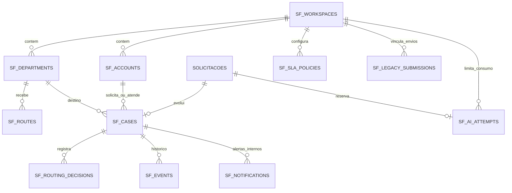
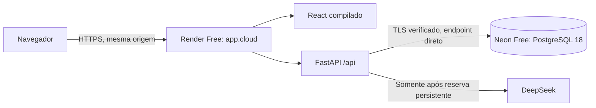

# Arquitetura SolicitaFlow

SolicitaFlow evolui o AI Request Classifier, preservando o histórico e a tabela
`solicitacoes`. O MVP de triagem humana continua disponível na central local;
a V2 acrescenta roteamento, atendimento, SLA e laboratório de demonstração.

## Componentes

- `frontend/src/Portals.jsx`: sessão, navegação e experiências por perfil.
- `LabGuide.jsx`: personagens e atendimento fictícios; novos pedidos usam IA real controlada.
- `Operations.jsx`: atendimento, políticas, alertas e relatórios.
- `ProcessEducation.jsx`: explicação da V2 e matriz determinística interativa.
- `App.jsx` e `pages/*`: interface clássica preservada, quatro abas.
- `useTheme.js` e `public/theme-init.js`: preferência automática/clara/escura,
  persistência local e aplicação inicial antes da renderização. Sem preferência salva,
  o padrão é Escuro; Automático salvo continua acompanhando o sistema.
- `BrandLogo.jsx`: variantes do pacote de marca conforme o tema resolvido.
- `ai_control.py`: orçamento global persistente, idempotência e concorrência da IA.
- `legacy_ai.py`: orçamento compartilhado pelo formulário técnico.
- `backend/app/identity.py`: contas, sessões opacas e autorização por recurso.
- `portals.py`: cadastro persistente, consultas, departamentos e revisão de exceções.
- `routing.py`: validação determinística e encaminhamento único com auditoria.
- `workflow.py` / `operations.py`: transições, SLA, alertas internos e relatório.
- `laboratory.py`: contextos fictícios isolados, expiração e tempo simulado.
- `ia.py` e `classificacao.py`: integração DeepSeek e matriz de prioridade original.
- `cloud.py` / `deployment.py`: frontend compilado, API pública, origem HTTPS, manutenção, headers e readiness.
- `retention.py`: limpeza de temporários expirados por atividade, com role separada.
- `scripts/check_sla.py`: agendamento apenas local, sem consumo de IA; não é iniciado no Render.

## Dados e fronteiras de confiança

As FKs compostas impedem vínculos entre ambientes. O serviço valida workspace,
perfil e propriedade em cada recurso; o frontend não é a fronteira de segurança.
O cabeçalho de contexto não autentica: é necessária uma sessão válida do tipo
correto. Cookies locais e de laboratório são separados. Role switch só existe no
laboratório e revoga o token anterior.

O pedido é confirmado antes de analisar. A sugestão original é preservada na
tabela existente. Categoria, impacto e urgência são validados pelo backend;
prioridade é calculada pela matriz. O encaminhamento usa lock de linha e índice
único. Revisão humana registra decisão separada e só trata exceções.

SLA usa regras determinísticas e snapshot da política no encaminhamento.
O scheduler local e as verificações por evento compartilham lock por ambiente e
notificações únicas por caso/tipo. Na nuvem não há scheduler permanente. Não há envio de mensagens externas. Tempo virtual é permitido
apenas em ambientes fictícios, sem alterar o relógio do sistema.

## Topologia pública e desenvolvimento local

O serviço publicado está em [https://solicitaflow.onrender.com](https://solicitaflow.onrender.com).
Um Render Web Service Free entrega `frontend/dist` e monta a API FastAPI em `/api`.
React/Vite produz o bundle; não existe Vite de desenvolvimento na nuvem.

A DeepSeek sugere os campos e a justificativa; Python valida o esquema, calcula a
prioridade e verifica o destino. IA real e processo demonstrativo são identificados
separadamente. Os dados e a sugestão original ficam persistidos antes das decisões
posteriores. Não existe retry pago automático após uma interrupção.

No Ubuntu/WSL, o desenvolvimento permanece independente: Vite 5173 → proxy `/api`
→ FastAPI 8000 → PostgreSQL 18 em 5432, todos em loopback. O proxy de desenvolvimento
não faz parte do bundle; na publicação o próprio FastAPI monta `/api`. A interface
clássica e as contas locais não são expostas no serviço público.

## Segurança, custo e disponibilidade

O ambiente público utiliza cookies host-only Secure/HttpOnly/Strict, validação de
origem/host, CSRF, autorização por recurso, headers de segurança e peers de proxy
explicitamente validados. O cabeçalho de contexto não substitui a sessão.
[SEGURANCA.md](SEGURANCA.md) descreve controles e limites de interpretação.

As reservas globais, por workspace/rede, tokens e orçamento ficam em PostgreSQL.
Um lock de sessão limita concorrência e uma reserva pendente durável mantém o
bloqueio se a conexão cair. Locks de sessão exigem o endpoint Neon direto; não usar
PgBouncer transacional nessa implementação. Segredos são exclusivos do backend.

Render e Neon podem suspender quando ociosos. `/health` só verifica o processo;
`/ready`, protegido por token operacional, verifica banco/TLS/role/esquema. O SLA
fictício é avaliado nas consultas/eventos e no avanço do relógio, sem prometer
monitoramento contínuo. Não foi instalado gatilho periódico do Neon, keep-alive ou
worker permanente. Retenção também é orientada a atividade.

## Migrações, evidências e histórico

As migrações oficiais 001–007 evoluem a tabela original e as entidades `sf_*`; a
`solicitacoes` mantém 22 colunas. No banco público novo, todas estão registradas em
`sf_schema_versions` por checksum. No ambiente local recuperado, o ledger da evolução
V2 registra 004–007; isso não autoriza reaplicar 001–003. O runtime tem role limitada;
testes locais usam outra role, sem CONNECT no principal. Credenciais de migração e
limpeza são separadas na nuvem. Não há migração automática no boot.

CI usa PostgreSQL 18 efêmero, preserva registro legado, valida rerun/checksums,
privilégios, backup/restauração e regressões backend/frontend/navegador com IA simulada.
O baseline funcional público é `e894487`, após PRs #16–#18. A tag `v2.6.1` permanece
em `8acaf71`, anterior ao deploy; encerramento documental posterior não modifica o
runtime com auto-deploy desabilitado.

Leia [DEPLOY_PUBLICO.md](DEPLOY_PUBLICO.md) para configuração, quotas e recuperação,
[GUIA.md](GUIA.md) para desenvolvimento e [ENCERRAMENTO.md](ENCERRAMENTO.md) para
evidências e manutenção. [V2.md](V2.md) e [PRE_DEPLOY.md](PRE_DEPLOY.md) preservam as
decisões históricas, não o estado operacional atual.
