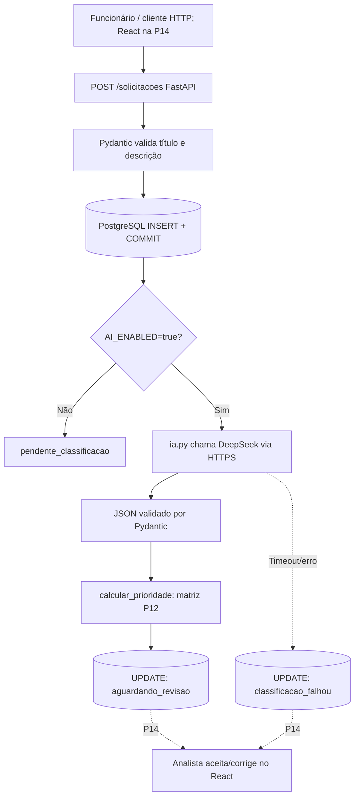

# Arquitetura técnica — AI Request Classifier

**Referência (15/10/2026):** P12 concluída; P13 em validação final. O desenvolvedor confirmou um POST real com `aguardando_revisao` e campos de IA preenchidos (id=13), além de fallback preservando o cadastro após HTTP 401 (id=8). GET posterior, execução da suíte automatizada após a P13 e commit/push ainda não foram confirmados.

## 1. Problema e escopo

O sistema registra solicitações internas, sugere triagem por IA e permite revisão por analista. Uma sugestão de categoria ou prioridade **não conclui nem resolve** a solicitação.

## 2. Fluxo técnico e regra empresarial



**Decisão central:** o cadastro é confirmado no PostgreSQL **antes** da chamada à IA, em transações diferentes. Uma falha externa não apaga o registro original. O POST espera a resposta externa quando a IA está ativada; essa sincronização é adequada ao MVP didático, não a uma solução escalável comprovada.

## 3. Módulos

| Arquivo | Responsabilidade |
|---|---|
| `app/main.py` | FastAPI e endpoint `/health` |
| `app/schemas.py` | Validação dos dados do cliente |
| `app/database.py` | Conexão PostgreSQL + leitura do `.env` |
| `app/classificacao.py` | Enums e matriz de prioridade da P12 |
| `app/ia.py` | Construção do prompt, HTTPS, parsing e validação da resposta da LLM |
| `app/triagem.py` | Persistência da sugestão ou sinalização de falha |
| `app/routes/solicitacoes.py` | CRUD preservado; POST chama triagem após COMMIT |
| `sql/002_add_classificacao_ia.sql` | Migração incremental das colunas de sugestão |
| `tests/test_ia.py` | JSON e HTTP simulados, sem consumo real de API |
| `tests/test_triagem.py` | Integração da triagem com banco isolado e IA simulada |

## 4. Persistência

Banco principal: `ai_request_classifier`, PostgreSQL Windows em `127.0.0.1:5433`. Banco de testes: `ai_request_classifier_test`. **Não confundir com PostgreSQL Docker na porta 5432.**

Tabela `solicitacoes`, colunas da P11:

| Coluna | Tipo |
|---|---|
| `id` | BIGINT IDENTITY PRIMARY KEY |
| `titulo` | VARCHAR(120), validado |
| `descricao` | TEXT, validado |
| `status` | VARCHAR(40) com padrão `pendente_classificacao` |
| `criado_em` | TIMESTAMPTZ |

A P13 acrescenta colunas opcionais sem apagar dados preexistentes: `categoria_sugerida`, `impacto_sugerido`, `urgencia_sugerida`, `prioridade_sugerida`, `justificativa_ia`, `modelo_ia`, `tokens_entrada`, `tokens_saida`, `latencia_ia_ms`, `classificado_em`.

Estados utilizados na P13:

| Estado | Condição |
|---|---|
| `pendente_classificacao` | IA desabilitada; somente cadastro |
| `aguardando_revisao` | Sugestão da IA validada e persistida |
| `classificacao_falhou` | Erro externo ou resultado inválido; cadastro preservado |

Os estados finais após decisão humana serão definidos na P14.

## 5. Contrato com a IA

Provedor didático: DeepSeek; endpoint HTTPS `/chat/completions`, modelo configurável `deepseek-flash`. O backend solicita um objeto JSON com **categoria, impacto, urgência e justificativa**, sem pedir a prioridade, calculada em Python segundo a matriz da P12.

Exemplo de resposta esperada:

```json
{
  "categoria": "suporte_ti",
  "impacto": "equipe",
  "urgencia": "alta",
  "justificativa": "Equipe impedida de acessar o sistema durante o expediente."
}
```

Validação: Enums restringem categoria/impacto/urgência; Pydantic rejeita campos extras ou justificativas fora dos limites; respostas vazias ou truncadas não são usadas. O título/descrição são tratados no prompt como **dados não confiáveis**, sem executar instruções presentes neles. O modelo pode errar semanticamente mesmo devolvendo JSON válido; a revisão humana é obrigatória no MVP.

## 6. Confiabilidade e limites

- Chave da API somente em `.env` local; `.env.example` nunca contém segredo real.
- Timeout de 12 segundos na chamada; uma falha externa não provoca rollback do INSERT já confirmado.
- Testes são executados com IA simulada para não depender de rede, cota ou cobrança externa.
- O PostgreSQL de testes é truncado apenas após checagem do nome do banco.
- `urllib.request` usa conexão HTTPS; métricas de tokens e latência são registradas quando disponíveis. Uma execução real com a DeepSeek reportou 329 tokens de entrada, 54 de saída e 1.012 ms; média de latência e custos ainda não foram medidos.
- Nesta versão, falha na persistência do resultado pode deixar a solicitação no estado inicial, exigindo diagnóstico administrativo. Retentativas, idempotência, fila e monitoramento não estão implementados.
- Ainda não existem controle de acesso, limitação de requisições, logs de auditoria ou proteção apropriada para dados sensíveis. Somente ambiente de desenvolvimento e informações fictícias.

## 7. Próximas entregas

P13: confirmar GET após o POST #13, suíte completa de testes com banco isolado, revisão do staging e commit/push; P14: endpoints e frontend React de revisão humana; P15: avaliação de acurácia, métricas, testes finais, privacidade, auditoria do Git, licença e eventual publicação autorizada.
