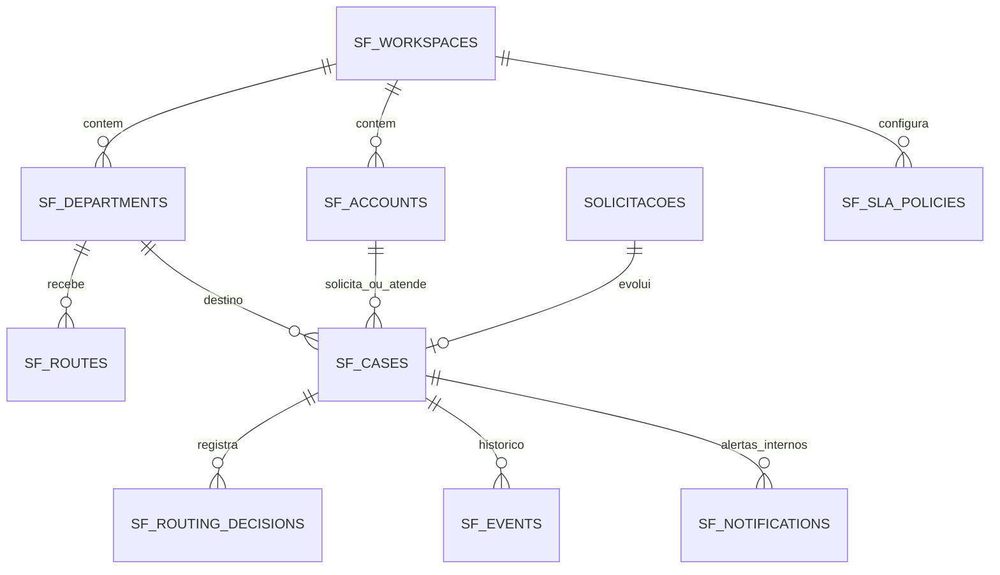

# Arquitetura SolicitaFlow

SolicitaFlow evolui o AI Request Classifier, preservando o histórico e a tabela
`solicitacoes`. O MVP de triagem humana continua disponível na central local;
a V2 acrescenta roteamento, atendimento, SLA e laboratório de demonstração.

## Componentes

- `frontend/src/Portals.jsx`: sessão, navegação e experiências por perfil.
- `LabGuide.jsx`: personagens fictícios e jornada guiada sem IA externa.
- `Operations.jsx`: atendimento, políticas, alertas e relatórios.
- `ProcessEducation.jsx`: explicação da V2 e matriz determinística interativa.
- `App.jsx` e `pages/*`: interface clássica preservada, quatro abas.
- `useTheme.js` e `public/theme-init.js`: preferência automática/clara/escura,
  persistência local e aplicação inicial antes da renderização.
- `backend/app/identity.py`: contas, sessões opacas e autorização por recurso.
- `portals.py`: cadastro persistente, consultas, departamentos e revisão de exceções.
- `routing.py`: validação determinística e encaminhamento único com auditoria.
- `workflow.py` / `operations.py`: transições, SLA, alertas internos e relatório.
- `laboratory.py`: contextos fictícios isolados, expiração e tempo simulado.
- `ia.py` e `classificacao.py`: integração DeepSeek e matriz de prioridade original.
- `scripts/check_sla.py`: agendamento em processo de usuário, sem consumo de IA.

## Dados e fronteiras de confiança

As FKs compostas impedem vínculos entre ambientes. O serviço valida workspace,
perfil e propriedade em cada recurso; o frontend não é a fronteira de segurança.
O cabeçalho de contexto não autentica: é necessária uma sessão válida do tipo
correto. Cookies locais e de laboratório são separados. Role switch só existe no
laboratório e revoga o token anterior.

O pedido é confirmado antes de analisar. A sugestão original é preservada na
tabela existente. Categoria, impacto e urgência são validados pelo backend;
prioridade é calculada pela matriz. O encaminhamento usa lock de linha e índice
único. Revisão humana registra decisão separada e só trata exceções.

SLA usa regras determinísticas e snapshot da política no encaminhamento.
Scheduler e verificação manual compartilham lock por ambiente e notificações
únicas por caso/tipo. Não há envio de mensagens externas. Tempo virtual é permitido
apenas em ambientes fictícios, sem alterar o relógio do sistema.

## Execução, migrações e qualidade

Frontend Vite 5173 → proxy `/api` → FastAPI 8000 → PostgreSQL 18 em 5432.
Todos ficam em loopback no laboratório local. DeepSeek recebe dados somente
quando o operador habilita explicitamente o fluxo real controlado.

Migrações 001–003 originais permanecem intactas. 004–006 são aditivas e versionadas
por checksum. A aplicação usa role limitada; o usuário de testes é separado e não
conecta ao principal. CI provisiona PostgreSQL efêmero, verifica compatibilidade
com registro legado e executa testes backend/frontend/build/navegador/acessibilidade.

Leia [V2.md](V2.md) para contratos completos, políticas fictícias e controles
exigidos antes de qualquer futura publicação Render/Neon.
