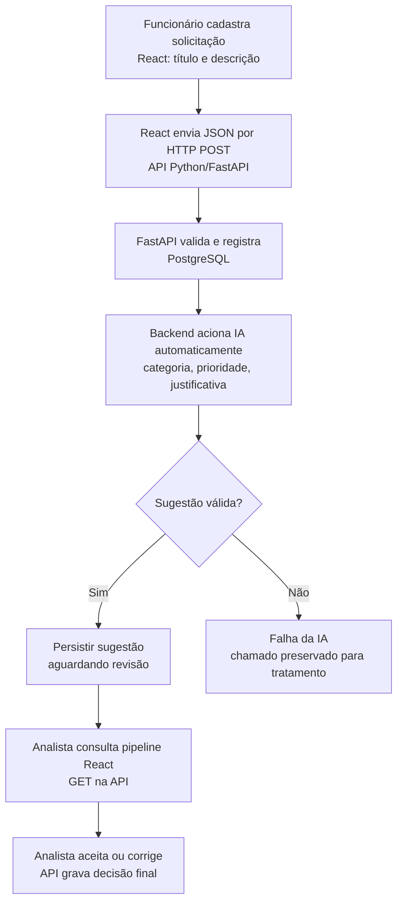

# Plano de Estudos e Dicas | AI Request Classifier

**Versão:** 3.27
**Data:** 13/10/2026
**Responsável:** desenvolvedor do AI Request Classifier
**Estado:** **P01–P07 concluídas** por confirmação de execução e compreensão; **P08 não iniciada**, aguardando autorização.

## Objetivo do projeto

Implementar uma aplicação de triagem de solicitações internas: funcionário preenche título e descrição no React; API Python/FastAPI valida e registra no PostgreSQL; **classificação por IA é acionada automaticamente**, sugerindo categoria, prioridade e justificativa; analista vê sugestões no pipeline React e **aceita ou corrige**. Não existe botão para iniciar manualmente a IA. Classificar não equivale a resolver o chamado.

## Diagrama único: operação empresarial + arquitetura

**Estado técnico:** o fluxo empresarial completo continua **planejado**. A P06 implementou `GET /health`; a P07 implementou `POST /solicitacoes`, validação Pydantic, HTTP 201/422 e armazenamento temporário em lista Python, conforme execução confirmada pelo desenvolvedor. **Ainda não há PostgreSQL, classificação automática por IA, frontend React ou pipeline funcional**. Não foram fornecidos logs brutos ou verificação externa.

## Como estudar a partir da P06

- O desenvolvedor digita e executa pessoalmente o código do backend; o orientador explica e revisa.
- **Apresentar a aula inteira de uma vez**, com objetivo, explicação, um diagrama negócio+técnica por fluxo, prática completa, resultados esperados, testes, exercício e quando commitar.
- Executar no próprio ritmo. Se uma etapa falhar, corrigir antes das dependentes. A aula só é concluída com execução e compreensão validadas; não avançar sem autorização.
- Preferir exemplos ligados ao produto, definições objetivas e explicação dos novos comandos/símbolos. Anotar em papel as decisões, falhas e resultados.

## Trilha prática

- [ ] **P00:** problema empresarial e arquitetura. Apresentada, sem avaliação formal; avanço autorizado.
- [x] **P01:** estrutura inicial, Git, GitHub privado, README e proteção de arquivos.
- [x] **P02:** Python 3.14.7, `.venv`, primeiro programa com `print()`.
- [x] **P03:** variáveis, `str`, `int`, `bool` e dados de solicitação.
- [x] **P04:** `if/else`, `in`, `lower()`, funções `def`, parâmetros e `return`.
- [x] **P05:** HTTP/JSON conceituais, `GET`, `POST`, dicionário e `json.dumps()`.
- [x] **P06:** primeira API com FastAPI, Uvicorn, `GET /health`, documentação e testes. **Concluída em 13/10/2026 por confirmação do desenvolvedor e avaliação das respostas A-D.**
- [x] **P07:** cadastro via POST JSON, validação Pydantic e registro em memória. **Concluída em 13/10/2026: testes e exercícios confirmados; commit e push informados pelo desenvolvedor.**
- [ ] **P08:** CRUD inicial de solicitações em memória.
- [ ] **P09:** organização do código, testes e documentação técnica.
- [ ] **P10:** PostgreSQL e SQL aplicado.
- [ ] **P11:** persistência e consultas parametrizadas.
- [ ] **P12:** categorias, prioridades e avaliação com exemplos.
- [ ] **P13:** API de IA, instruções, custo, latência e privacidade.
- [ ] **P14:** classificação automática e tratamento de falhas.
- [ ] **P15:** revisão humana e estados do pipeline.
- [ ] **P16:** interface React.
- [ ] **P17:** integração React → API → IA → revisão.
- [ ] **P18:** testes, qualidade e segurança.
- [ ] **P19:** documentação e demonstração técnica.
- [ ] **P20:** publicação, somente após autorização e revisão.

## Evidências e Git

| Etapa | Evidência/estado | Versionamento |
|---|---|---|
| P01 | Repositório Git iniciado e remoto informado | Primeiro commit `a38d48c`, push confirmado |
| P02 | Ambiente virtual e programa executados, conforme confirmação | Commit específico não informado |
| P03 | Exercícios respondidos e execução confirmada | `a63e068`, push confirmado |
| P04 | Condições e funções compreendidas; dois testes confirmados | Commit/push relatados; hash não informado |
| P05 | Conceitos HTTP/JSON validados e `json.dumps()` executado | Commit/push confirmados pelo desenvolvedor como "tudo ok"; hash não informado |
| P06 | Respostas A-D corretas com ajustes terminológicos; API e testes relatados como funcionando | Commit/push confirmados por relato em 13/10/2026; hash não informado |
| P07 | Testes HTTP 201/422, `/health` 200 e ID incremental confirmados; respostas A–D revisadas e validadas | Commit/push confirmados pelo desenvolvedor em 13/10/2026; hash não informado |

**Ambiente:** Windows, VS Code, PowerShell, Python 3.14.7, `backend/.venv/` existente. Repositório informado: [AI Request Classifier](https://github.com/waldirevora/ai-request-classifier), com decisão de mantê-lo **privado até a conclusão e auditoria pré-publicação**. A visibilidade não foi auditada independentemente.

## P06: registro de conclusão

- FastAPI e Uvicorn: instalação e execução informadas como concluídas pelo desenvolvedor.
- Endpoint local: `GET /health` retorna `{"status":"ok"}` por relato; documentação `/docs` e testes HTTP fazem parte da prática que o desenvolvedor informou estar funcionando.
- Exercício A: FastAPI relaciona rotas e funções Python; Uvicorn mantém o servidor recebendo conexões. **Correto.**
- Exercício B: `GET /health` chega ao Uvicorn, FastAPI executa a rota e retorna **JSON ao cliente**. Correção da expressão "recebe a biblioteca".
- Exercício C: P05 só convertia **dicionário Python** para texto JSON com `json.dumps()`; não tinha servidor HTTP. Correção do termo "biblioteca".
- Exercício D: ao interromper Uvicorn, o endpoint local deixa de responder. **Correto.**
- Git: commit e push de P06 informados como concluídos, sem hash ou mensagem observada. Não presumir verificação remota independente.
- **Próxima ação:** aguardar autorização para a P08. P07 já executada, revisada e versionada conforme confirmação do desenvolvedor.

## P07: cadastro de solicitações com FastAPI (concluída)

**Conclusão:** 13/10/2026. Código do backend implementado e testes realizados conforme confirmação do desenvolvedor, sem inspeção direta do repositório pelo orientador.

**Implementado:** `POST /solicitacoes` em FastAPI, entrada por `BaseModel` Pydantic e `Field`, restrições de tamanho título (3–120) e descrição (10–2000), registro com ID incremental em lista Python e status `pendente_classificacao`, resposta JSON HTTP `201`. FastAPI devolve `422` para dados inválidos. A rota `GET /health` continua respondendo `200`.

**Testes confirmados:** corpo válido 201; título e descrição curtos 422; campo descrição ausente 422; `/health` 200; cadastros sucessivos incrementam o ID enquanto o processo continua.

**Exercícios A–D:** todos conceitualmente corretos. Pydantic valida entrada; 201 = **recurso criado** e 422 = **falha na validação**; RAM perde registros na reinicialização do processo; IA não está integrada, exigirá API do modelo, instruções, validação do resultado e acionamento automático pelo backend após cadastro.

**Limitações:** sem banco persistente, sem IA, sem pipeline React, sem GET/atualização/exclusão de solicitações; IDs em lista são didáticos e não garantem segurança sob concorrência. Validar apenas comprimento não bloqueia espaços em branco.

**Git:** commit e push da P07 confirmados por relato em 13/10/2026; hash, mensagem efetiva e status remoto não foram apresentados. Mensagem anteriormente sugerida: `feat: adiciona cadastro de solicitacoes com validacao`. Não presumir que a documentação local foi sincronizada; atualização do guia público poderá exigir commit `docs` separado quando o desenvolvedor substituir sua cópia.

**Próxima etapa:** P08, CRUD inicial em memória, **não iniciada**. Esperar autorização do desenvolvedor e manter o formato de aula integral numa resposta.

## Dicas de desenvolvimento

- Antes da execução, prever o resultado; depois comparar com a saída real.
- Quando houver erro, identificar comando, mensagem, causa e correção validada. Não ocultar falhas.
- Aprender cada símbolo novo do código, mas evitar teoria dissociada da prática.
- Fazer commits de incrementos funcionais, com mensagens objetivas em português (`feat`, `fix`, `test`, `docs`, `refactor`). Não usar `git add .` sem revisar arquivos incluídos.
- Um diagrama integrado para cada fluxo: **quem age, quais dados, qual tecnologia, como responde e qual estado**.
- Anotar em papel: objetivo, conceitos, diagrama, código, saída observada, dúvidas e conclusão própria.

## Referências

- [README do projeto](../README.md)
- [Primeiros passos do FastAPI](https://fastapi.tiangolo.com/pt/tutorial/first-steps/)
- [Servidor FastAPI/Uvicorn](https://fastapi.tiangolo.com/pt/deployment/manually/)
- [Documentação Python](https://docs.python.org/pt-br/3/)
