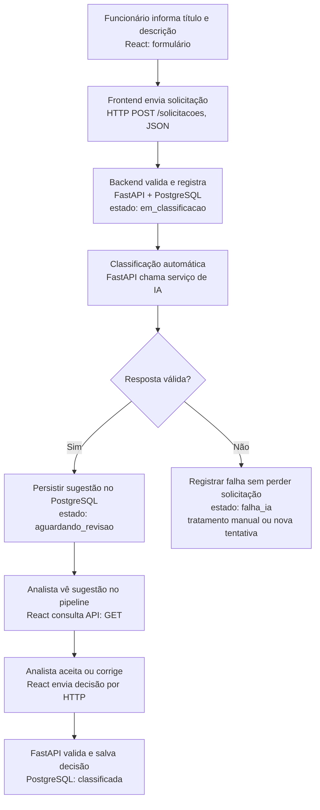

# Plano de Estudos e Dicas | AI Request Classifier

**Versão:** 2.6

**Data de atualização:** 12/10/2026

**Situação:** P01 em estudo. Três arquivos foram adicionados ao staging, mas o primeiro commit ainda não foi executado. A última verificação encontrou três linhas com espaços finais no guia; correção e nova verificação pendentes. Privacidade do GitHub e primeiro `push` não confirmados.

## O que estamos construindo

Aplicação demonstrativa para organizar solicitações internas de uma empresa. O funcionário registra o título e a descrição; o backend salva os dados e **aciona automaticamente um modelo de IA** para sugerir categoria, prioridade e justificativa. O analista recebe a sugestão no pipeline do frontend e **aceita ou corrige**. A decisão final é registrada no banco.

**Tecnologias planejadas:** Python e FastAPI no backend, PostgreSQL para persistência, React no frontend, API de modelo de IA para classificação, Git e GitHub desde o início. O uso dessas tecnologias é planejado, não evidência de implementação.

### Fluxo de negócio e arquitetura, no mesmo diagrama



O diagrama é **planejamento**, não funcionalidade pronta. A classificação automática não implica decisão automática nem resolução do chamado. Um atendimento pode continuar aberto depois de classificado. Não presumir melhora de tempo, SLA, acurácia ou aprendizado contínuo sem testes e medições.

## Como estudar e desenvolver

- Avançar uma etapa por vez, com explicações curtas: objetivo, motivo técnico, exemplo, prática e validação.
- Digitar e executar pessoalmente o backend Python, comandos Git, testes e operações de publicação. O frontend React pode receber apoio de IA, mantendo a compreensão das integrações.
- Trabalhar em rodadas de 3 a 5 ações; explicar erros e revisar resultados antes de seguir. Nenhum passo futuro é presumido concluído.
- Usar um **diagrama integrado** para cada fluxo relevante, mostrando juntos o processo empresarial e a implementação técnica.
- Anotar em papel: objetivo, conceito, fluxo, comandos, resultado observado, erro e explicação própria.
- Usar dados fictícios; não publicar senhas, tokens, dados de terceiros ou configurações privadas. **Repositórios privados também exigem proteção de segredos.**
- Manter o **repositório GitHub privado** durante o desenvolvimento, por decisão de 12/10/2026. A URL foi fornecida, mas a visibilidade deve ser conferida no GitHub. Torná-lo público somente quando o MVP estiver pronto, com revisão de conteúdo e histórico Git e aprovação explícita. Não criar recursos com cobrança nem fazer deploy sem autorização.

**Identidade no projeto:** o responsável pelo AI Request Classifier é o **desenvolvedor**. Este guia documenta sua aprendizagem aplicada e o desenvolvimento autoral do sistema; apresenta o trabalho como desenvolvimento autoral e aprendizagem aplicada.

## Trilha prática ativa

Legenda: `[ ]` ainda não concluída. Estados: **não iniciada**, **em estudo**, **em revisão**, **concluída após validação**. Uma etapa apresentada não é uma etapa concluída.

### Fase A | Início e Python aplicado

- [ ] **P00:** Problema empresarial, arquitetura e fluxo; **apresentada, sem avaliação formal; avanço autorizado**.
- [ ] **P01:** Estrutura local, Git e GitHub desde o início, README, guia e primeiro commit; **em estudo**.
- [ ] **P02:** Verificar Python, ambiente virtual e executar o primeiro arquivo.
- [ ] **P03:** Representar solicitações com strings, variáveis e saídas.
- [ ] **P04:** Classificação inicial por regras simples, condições, funções e testes manuais.

### Fase B | Primeira API

- [ ] **P05:** HTTP, JSON, requisição, resposta e papel do FastAPI.
- [ ] **P06:** Primeiro endpoint e servidor local.
- [ ] **P07:** Receber dados via POST e validá-los.
- [ ] **P08:** CRUD simples de solicitações em memória.

### Fase C | Organização e banco de dados

- [ ] **P09:** Consolidar commits, documentação e organização do código.
- [ ] **P10:** PostgreSQL e SQL aplicados a solicitações.
- [ ] **P11:** Persistência real, conexão, consultas seguras e erros.

### Fase D | IA e revisão humana

- [ ] **P12:** Categorias, prioridades e casos de avaliação.
- [ ] **P13:** APIs de IA, prompts, tokens, latência, privacidade e custo.
- [ ] **P14:** IA acionada automaticamente após o cadastro, validação de saída e recuperação de falhas.
- [ ] **P15:** Pipeline de revisão humana: aceitar/corrigir e registrar decisões.

### Fase E | React, testes e demonstração

- [ ] **P16:** Interface React com apoio de IA e comunicação com o backend.
- [ ] **P17:** Integração do ciclo cadastro -> IA -> revisão -> registro.
- [ ] **P18:** Testes automatizados, qualidade e segurança básica.
- [ ] **P19:** Documentação da arquitetura real e demonstração local.
- [ ] **P20:** Publicação opcional, após MVP validado, revisão de segurança e autorização.

*A trilha original de 46 aulas do Prompt Mestre V2 foi substituída por esta sequência prática por decisão posterior do desenvolvedor. Fundamentos serão ensinados no momento em que forem necessários.*

## Registro de progresso

| Etapa | Estado | Evidência resumida | Próxima validação |
|---|---|---|---|
| P00 | Apresentada, sem validação formal | Problema de negócio e arquitetura discutidos; início da P01 autorizado | Relembrar conceitos quando necessário |
| P01 | Em estudo | Windows/VS Code; Git local na branch `master`; `.gitignore` validado; README conferido em UTF-8. `git add .` preparou exatamente três arquivos: `.gitignore`, `README.md`, `docs/PLANO_DE_ESTUDOS_E_DICAS.md`. `git diff --cached --stat` indicou 197 inserções; `git diff --cached --check` apontou espaços finais nas linhas 3, 4 e 94 do guia. | Corrigir os espaços e o status desatualizado, re-adicionar somente o guia, verificar o staging e confirmar Private antes de qualquer push |
| P02 a P20 | Não iniciadas | Nenhuma execução confirmada | Avançar após validação da P01 |

**GitHub:** URL fornecida pelo desenvolvedor: `https://github.com/waldirevora/ai-request-classifier.git`. O staging local dos três arquivos foi comprovado em 12/10/2026, mas o guia preparado para esse staging tinha uma frase de progresso desatualizada. Privacidade efetiva, estado remoto, primeiro commit, configuração de `remote` e `push` **não foram confirmados**.

**Funcionalidades:** nenhuma API, integração IA, frontend ou banco implementado e testado até esta atualização.

## Política de visibilidade no GitHub

- **Durante o curso:** manter repositório privado e verificar a indicação **Private** na interface antes de enviar código. URL informada: `https://github.com/waldirevora/ai-request-classifier.git`. Conferir se o remoto foi criado sem README/.gitignore/licença automáticos.
- **Quando o MVP estiver pronto:** revisar arquivos públicos, segredos, variáveis de ambiente, dados fictícios, documentação, testes e **todo o histórico de commits**; solicitar confirmação antes de mudar para público.
- **Estado:** decisão de privacidade e URL confirmadas pelo desenvolvedor; visibilidade real do remoto e primeiro `push` não confirmados.

## Dicas práticas

1. Antes de olhar a resposta, tente prever o resultado de um comando ou trecho de código.
2. Explique cada linha com suas palavras e altere apenas um detalhe por teste.
3. Anote o texto essencial dos erros e como a correção foi validada.
4. Faça commits pequenos, com mensagens que descrevam alterações reais.
5. Diferencie **planejado**, **executado**, **testado** e **publicado**.
6. Revise conteúdos anteriores em intervalos curtos, conforme sua dificuldade.
7. Só marque uma etapa concluída quando conseguir explicar seu propósito e reproduzir a prática principal.

## Estrutura planejada de referência

```text
ai-request-classifier/
├── README.md
├── .gitignore
├── docs/
│   ├── PLANO_DE_ESTUDOS_E_DICAS.md
│   └── ARQUITETURA.md                 (futuro)
├── backend/
│   └── app/                          (futuro)
└── frontend/                         (futuro)
```

Pastas e arquivos marcados como futuros não devem ser criados antecipadamente apenas para coincidir com o desenho. O Git não rastreia diretórios vazios.

## Critério de conclusão de cada etapa

- [ ] Executei ou demonstrei a prática pessoalmente.
- [ ] Consegui explicar o que aconteceu e por quê.
- [ ] Conferi os resultados ou testes e corrigi os erros relevantes.
- [ ] Registrei o progresso com evidência verdadeira.
- [ ] Autorizei o avanço à etapa seguinte.

## Referências

- [README do projeto](../README.md)
- [Documentação oficial do Python](https://docs.python.org/pt-br/3/)
- [Documentação oficial do Git](https://git-scm.com/docs)

As fontes oficiais são referências de consulta, não conteúdo declarado como estudado. O guia será atualizado ao final de cada etapa validada e sempre que uma decisão relevante mudar.
