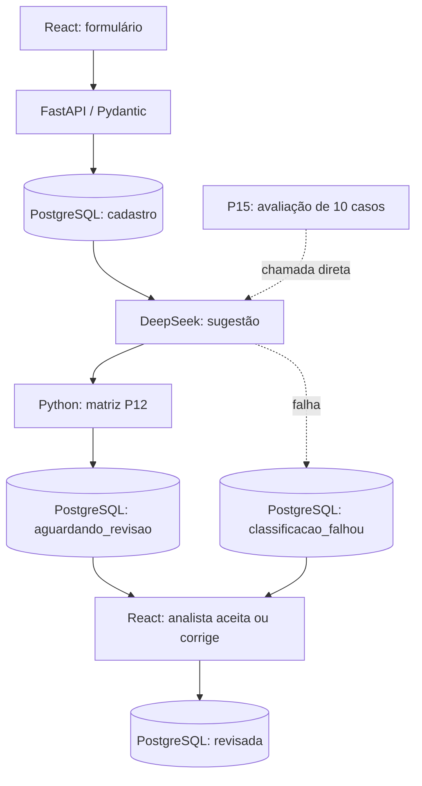

# Plano de Estudos e Dicas | AI Request Classifier

**Versão:** 3.65
**Status:** P01–P14 concluídas segundo evidências do desenvolvedor; P15 em execução. GitHub privado até auditoria e autorização explícita.

## Objetivo de negócio

Funcionário registra solicitação interna pelo React; FastAPI persiste no PostgreSQL e chama automaticamente DeepSeek; IA sugere categoria, impacto, urgência e justificativa; Python calcula prioridade pela matriz P12; analista aceita ou corrige no React; backend registra decisão final. Erros da IA não podem apagar o cadastro. Classificar não significa resolver o chamado.

## Arquitetura integrada

## Regras de acompanhamento

- Aula concisa, porém explicando o **porquê** das escolhas, o caminho entre componentes, termos relevantes, testes e Git.
- O desenvolvedor executa os comandos; o assistente valida evidências sem inventar resultados.
- Arquivos de documentação entregues completos, para substituição integral.
- **Guia oficial:** `docs/GUIA.md` (mesmo caminho, substituir o arquivo completo em cada atualização; **não** manter na raiz, nem criar guias numerados).
- Prompt de continuidade privado: `PROMPT_CONTINUIDADE_AI_REQUEST_CLASSIFIER.md`, fora do Git.
- Sempre encerrar aulas com status atualizado das entregas até a conclusão.
- Repositório privado até fim do desenvolvimento e auditoria autorizada; aplicação apenas localhost sem autenticação.

## Progresso histórico

| Etapa | Conteúdo | Situação |
|---|---|---|
| P01–P09 | Fundamentos, FastAPI, validações, CRUD e testes | Concluída |
| P10–P11 | PostgreSQL, consultas parametrizadas, testes isolados; commit P11 `62d5b7a` | Concluída |
| P12 | Taxonomia, matriz de prioridade e 10 casos de referência | Concluída; 25 testes totais na época, commit/push confirmados |
| P13 | DeepSeek `deepseek-flash`, chamada automática após cadastro, fallback e métricas | Concluída; sucesso real #13, commit/push confirmados |
| P14 | React/Vite, fila, aceite/correção e persistência da decisão humana | Concluída; **41 testes passaram**, build e testes manuais, commit/push `e5a4119` confirmado no Git |
| **P15** | **Métricas e avaliação, regressão, segurança, README comercial, auditoria, licença, publicação autorizada** | **Em execução** |

## P15 — ações verificáveis

1. **Concluído:** `backend/evaluation/avaliar_ia.py` e `backend/tests/test_avaliacao.py` instalados; prévia conferiu 10 casos sem API.
2. **Concluído:** 46 testes Python aprovados, ambiente `pip check` sem requisitos quebrados; `httpx2` mantido no `requirements-dev.txt` conforme testes locais. A adição de `pydantic` em `requirements.txt` foi revisada e aprovada.
3. **Concluído:** `npm ci`, `npm run build` (25 módulos, 1,16 s) e `npm audit` (0 vulnerabilidades reportadas).
4. **Concluído:** DeepSeek real, 10/10 respostas; categoria 90%, impacto 90%, urgência 70%, prioridade 90%, completo 60%; 3.289 tokens de entrada, 551 de saída, 1.215 ms de latência média. Custo em dinheiro ainda não calculado.
5. **Concluído:** divergências C03 e C05 (urgência), C08 (categoria), C09 (impacto, urgência, prioridade) interpretadas como possíveis ambiguidades de política e texto; a resposta específica da LLM não foi armazenada nesse resumo. Baseline mantido.
6. **Concluído:** `.env` fora do Git; `node_modules` e `dist` ignorados. Gitleaks avaliou 16 commits e cerca de 275 KB, sem segredos detectados.
7. **Concluído:** licença **MIT** aprovada pelo desenvolvedor; `LICENSE` pronto, atribuição `waldirevora` a conferir antes de salvar.
8. **Pendente:** copiar documentação completa atualizada, revisar o staging, realizar commit e push da P15 e comprovar Git sincronizado.
9. **Pendente:** obter autorização separada e explícita antes de tornar o repositório público. A aplicação continuará apenas local, sem deploy público.

## Conceitos importantes

- **Acurácia em uma amostra**: fração de classificações iguais aos rótulos de referência; dez exemplos não representam todo o negócio.
- **Latência**: tempo da chamada de IA; não é o tempo total de navegação ou de ponta a ponta.
- **Tokens**: unidades processadas/geradas pelo modelo, usadas na cobrança; custo requer tarifa vigente e eventual distinção cache hit/miss.
- **Fallback**: solicitação permanece salva e a revisão manual segue possível se a IA falhar.
- **Prompt injection**: tentativa de usar texto não confiável da solicitação para alterar a conduta do modelo; instruções no system prompt são defesa parcial, não garantia.
- **E2E**: teste ponta a ponta do fluxo real usuário–frontend–backend–banco–revisão.
- **Publicação de código x deploy**: GitHub público não equivale a aplicação hospedada e segura; sem login não expor o serviço à internet.

## Ambiente

Windows PowerShell em `D:\Projects\ai-request-classifier`, Python 3.14.7 em `backend/.venv`, PostgreSQL Windows `127.0.0.1:5433`, banco de produção de laboratório `ai_request_classifier`, banco de testes **destrutivo** `ai_request_classifier_test`; outra instância PostgreSQL Docker em 5432. Se psql não for localizado, usar `$env:Path += ";C:\Program Files\PostgreSQL\18\bin"` na sessão. Vite local porta 5173; FastAPI 8000.

## Status até o fim

**14/15 etapas concluídas (93,3% por etapas, não por funcionalidades).** A P15 está em fechamento: testes, métricas, análise das divergências e varredura de segredos concluídos. Falta revisão do staging, commit/push e decisão de visibilidade do repositório. O código terá licença MIT; publicar não significa hospedar o sistema.
