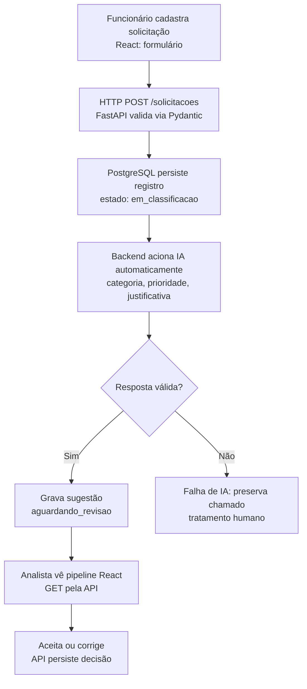

# Plano de Estudos e Dicas | AI Request Classifier

**Versão:** 3.42
**Atualização:** 15/10/2026
**Responsável:** desenvolvedor do AI Request Classifier
**Estado:** **P01 a P09 concluídas.** **P10 em andamento:** PostgreSQL 18.6 Windows `127.0.0.1:5433`, banco, tabela, operações SQL, restrições, transações e persistência demonstrados em logs. Teste isolado de título e cinco testes `pytest` aprovados por confirmação do desenvolvedor. Exercícios A–F validados após confirmação das correções de A e F; documentação README/ARQUITETURA ainda não atualizada conforme o desenvolvedor; Git P10 pendente. **P11 não iniciada.**

## Objetivo do produto

Aplicação de triagem de solicitações internas de empresas. Funcionário cadastra título e descrição; backend valida e armazena; **IA é acionada automaticamente após o cadastro** e sugere categoria, prioridade e justificativa; analista recebe a sugestão no pipeline React e aceita ou corrige. Classificação não equivale a atendimento concluído. Nenhum clique do analista será necessário para iniciar a classificação.

## Arquitetura integrada de referência (planejada)



**Implementação de API até P09 e prática SQL confirmada parcialmente na P10:** Python local, FastAPI/Uvicorn, `GET /health`, POST, GET lista/detalhe, PUT e DELETE em `/solicitacoes`, validação Pydantic, 200/201/204/404/422, contador de IDs e lista temporária em memória. **Ainda não implementados:** React, integração PostgreSQL no FastAPI, serviço de IA, pipeline e classificação automática. PostgreSQL Docker na porta 5432 foi informado pelo desenvolvedor; PostgreSQL 18.6 Windows foi comprovado em 127.0.0.1:5433, e o banco `ai_request_classifier` foi criado e acessado. A tabela `public.solicitacoes` foi criada e sua estrutura confirmada pelo desenvolvedor em 15/10/2026; a API ainda não se conecta a ela.

## Método de aprendizagem

- O **desenvolvedor** digita e executa pessoalmente o backend, os testes e os comandos Git; o orientador explica, revisa e registra decisões.
- Apresentar a **aula inteira de uma vez**: objetivo, conceitos essenciais, **diagrama único com fluxo empresarial e técnico**, prática incremental, testes, exercício e indicação de commit.
- Manter a explicação breve e tecnicamente precisa, sem pular conceitos novos. Erros são diagnosticados antes de avançar.
- **Não concluir uma aula sem prática e compreensão confirmadas**; não avançar sem autorização.
- Nunca publicar segredos, tokens ou dados privados; o GitHub permanecerá privado até revisão e autorização.

## Trilha prática

- [ ] **P00:** problema empresarial e arquitetura. Apresentada; sem avaliação formal, avanço autorizado.
- [x] **P01:** projeto, Git, GitHub privado, README e `.gitignore`.
- [x] **P02:** Python 3.14.7, `.venv`, execução de script.
- [x] **P03:** variáveis, `str`, `int`, `bool`.
- [x] **P04:** `if/else`, palavras-chave e funções (`def`, `return`).
- [x] **P05:** HTTP/JSON, dicionário e `json.dumps()`.
- [x] **P06:** FastAPI/Uvicorn, `GET /health`, `/docs` e testes HTTP.
- [x] **P07:** `POST /solicitacoes`, Pydantic, `201`/`422`, lista em memória; **commit e push informados como concluídos**.
- [x] **P08:** GET lista/detalhe, PUT, DELETE, erros 404/422, resposta 204 e IDs crescentes; 5/5 respostas e testes confirmados; commit/push informados.
- [x] **P09: concluída em 15/10/2026.** Estrutura modular, pytest/TestClient (cinco testes aprovados sem avisos após `httpx2`), Swagger/endpoints confirmados, documentação e Git versionados, **6/6 respostas conceituais corretas**.
- [ ] **P10: em estudo (15/10/2026).** Banco/tabela, restrições, SQL, transações, persistência e reteste confirmados; exercícios A–F aprovados; documentação e versionamento pendentes.
- [ ] **P11:** persistência e consultas parametrizadas.
- [ ] **P12:** categorias, prioridades e exemplos de avaliação.
- [ ] **P13:** API de IA, instruções, custo, latência e privacidade.
- [ ] **P14:** classificação automática e tratamento de falhas.
- [ ] **P15:** revisão humana e estados do pipeline.
- [ ] **P16:** interface React.
- [ ] **P17:** integração React → API → IA → revisão.
- [ ] **P18:** testes, qualidade e segurança.
- [ ] **P19:** documentação e demonstração técnica.
- [ ] **P20:** publicação somente após autorização.

## P08 concluída em 14/10/2026

- **Testes manuais:** desenvolvedor confirmou que todos funcionaram, incluindo POST 201, GET lista/detalhe 200, PUT 200, DELETE 204, 404/422, ID crescente após exclusão e `/health`.
- **Compreensão:** cinco respostas corretas: GET/PUT/DELETE; 404 para ID inexistente e 422 para parâmetro inválido; contador evita duplicação durante um processo; estado em memória é perdido após reinício; não existe IA automática ainda.
- **Git:** `git add`, commit e push P08 informados como concluídos pelo desenvolvedor. Não foram fornecidos hashes, mensagem final ou saída dos comandos; não alegar conferência independente.

## P09 concluída: código modular, testes e documentação

**Objetivo:** refatorar sem alterar comportamento. Separar a aplicação FastAPI, os schemas Pydantic, os dados temporários e as rotas. Automatizar testes de regressão e registrar o funcionamento real do protótipo.

**Estrutura proposta na aula:**

```text
backend/
  app/
    __init__.py
    main.py                # FastAPI, /health, include_router
    schemas.py             # campos e regras Pydantic
    storage.py             # lista, contador_ids e busca
    routes/
      __init__.py
      solicitacoes.py      # APIRouter: POST, GET lista/detalhe, PUT e DELETE
  tests/
    test_api.py            # 5 testes automatizados
  requirements.txt        # fastapi, uvicorn
  requirements-dev.txt    # referencia requirements.txt, pytest, httpx2
docs/
  ARQUITETURA.md           # visão de negócio, módulos, limites e próximos passos
  PLANO_DE_ESTUDOS_E_DICAS.md
README.md                  # atualizar com comandos, problema e estado real
```

**Conceitos:** módulo, pacote, responsabilidade única, import, router, refatoração sem mudar funcionalidade, testes de regressão e teste de API sem servidor real via `TestClient`.

**Regras da refatoração:** manter `GET /health`; `POST /solicitacoes` 201; `GET /solicitacoes` e GET por ID 200; `PUT` 200; `DELETE` 204 sem corpo; 404/422; `status: pendente_classificacao`; validações de título (3–120) e descrição (10–2000); IDs crescentes na mesma execução. Usar `from app import storage` para compartilhar o estado do módulo e `APIRouter(prefix="/solicitacoes")` para registrar as rotas. Nenhum banco, React ou IA nessa etapa.

**Testes implementados:** cinco funções `pytest`: (1) saúde/lista vazia; (2) cadastro e GET lista/detalhe; (3) entradas inválidas/ID inexistente; (4) edição e exclusão; (5) contador de ID após exclusão. `setup_function` deve limpar a lista e reiniciar o contador a cada teste para evitar dependência de ordem. Rodar no terminal em `backend`: `.\.venv\Scripts\python.exe -m pytest -q`. `TestClient` usa HTTP simulado em processo; verificação manual opcional de `/docs` com servidor Uvicorn. A referência foi executada isoladamente pelo orientador com cinco testes aprovados; **a execução local inicial em 14/10/2026 teve cinco testes aprovados e um aviso de depreciação; em 15/10/2026 o desenvolvedor confirmou o novo teste com `httpx2` sem avisos**.

**Documentação:** README deve explicar problema de negócio, o que já funciona, endpoints, setup/testes, limitações e próximos passos. `docs/ARQUITETURA.md` documentará responsabilidades e evolução planejada. Não inventar custos ou latências ainda não medidos. Guia público será sincronizado manualmente; prompt interno não deve ser versionado.

**Critérios de conclusão P09 satisfeitos:** estrutura modular, comportamento CRUD confirmado no Swagger, testes locais 5/5 sem avisos após dependência `httpx2`, documentação revisada e versionada, avaliação 6/6 correta, Git sincronizado conforme saída enviada. Não houve inspeção direta do computador.

## P09: evidência local recebida e ajuste de dependência (14/10/2026)

- O desenvolvedor executou `(.venv) PS D:\Projects\ai-request-classifier\backend> .\.venv\Scripts\python.exe -m pytest -q` e forneceu o resultado **`5 passed, 1 warning in 0.73s`**. Os cinco testes automatizados da P09 passaram; não foi enviada saída de verificação Swagger ou de Git nesta etapa.
- Aviso observado: `StarletteDeprecationWarning: Using httpx with starlette.testclient is deprecated; install httpx2 instead` (em `fastapi/testclient.py`). **Aviso de dependência, não falha dos testes.** A documentação oficial da Starlette informa que o `TestClient` passou a usar `httpx2` e que o `httpx` antigo ainda funciona, mas é depreciado: https://starlette.dev/testclient/.
- **Ajuste recomendado:** em `backend/requirements-dev.txt` trocar `httpx` por `httpx2` (manter `-r requirements.txt` e `pytest`); reinstalar via ambiente virtual e repetir `pytest -q`. Não suprimir o warning nem alterar os testes por esse motivo. Confirmar depois se o aviso desapareceu; não presumir antes da execução.
- **P09 concluída após confirmação de 15/10/2026:** o desenvolvedor informou que o reteste `pytest -q` passou sem avisos com `httpx2` e que todos os endpoints continuaram funcionando em `/docs`.

## Git e evidências

- Raiz informada: `D:\Projects\ai-request-classifier`, Windows/PowerShell/VS Code; venv em `backend/.venv`. Utilizar executável da venv, não o launcher `py` quebrado.
- Git `main`, origem informada `https://github.com/waldirevora/ai-request-classifier.git`, repo privado segundo decisão; visibilidade não auditada.
- Commits conhecidos com hashes: inicial `a38d48c`, P03 `a63e068`, P08 `7d6ed72`, refatoração P09 `6fb81df`, documentação P09 `e1ed02a`.
- P04 a P08 e documentação pós-P07: commits e pushes concluídos conforme relato do desenvolvedor; não inventar saída, hashes, staging ou sincronização remota auditada.
- **P09:** refatoração versionada no commit `6fb81df`; atualização de README, arquitetura e guia no commit `e1ed02a`. Push bem-sucedido (`6fb81df..e1ed02a main -> main`); `git status -sb` exibiu `## main...origin/main`, sem alterações. A divergência de histórico causada por `git commit --amend` foi solucionada sem push forçado: backup local `backup/p09-amend`, `git reset --soft origin/main`, inspeção de staging e novo commit exclusivo de documentação.
- Não versionar `.env`, segredos, `.venv`, `__pycache__`, dados reais nem arquivos `PROMPT_*.md`. Confirmar `.gitignore` e staging. Documentos gerados no chat não entram no repositório automaticamente.

## Próximo passo imediato

**P09 encerrada. P10 (PostgreSQL e SQL) não iniciada e depende de autorização expressa do desenvolvedor.** Antes de começar a P10, confirmar `git status -sb` após o ajuste `httpx2`, pois o último status limpo comprovado foi apresentado antes da confirmação final dos testes. Se houver mudança pendente em `requirements-dev.txt`, revisar e versionar separadamente.

## Dicas para registro no caderno

Registrar objetivo da refatoração, responsabilidades de `main.py`/`schemas.py`/`storage.py`/`routes/solicitacoes.py`, conceito de teste de regressão, diferença entre teste com `TestClient` e servidor Uvicorn, resultados efetivos, decisões e limitações de memória. Evitar confundir reorganização de código com criação de novas funcionalidades.

## Referências

- [README do projeto](../README.md)
- [Tutorial FastAPI](https://fastapi.tiangolo.com/pt/tutorial/)
- [Teste de aplicação FastAPI](https://fastapi.tiangolo.com/pt/tutorial/testing/)
- [Documentação pytest](https://docs.pytest.org/)
- [Documentação Python](https://docs.python.org/pt-br/3/)

## P09: compreensão validada (15/10/2026)

**Exercícios A–F: 6/6 corretos.** O desenvolvedor explicou separação de responsabilidades, APIRouter/include_router, `assert` e o relatório de falha do pytest, `setup_function`, TestClient sem servidor Uvicorn e a diferença entre refatorar e desenvolver novas funcionalidades.

**Concluído em 15/10/2026:** o desenvolvedor confirmou o novo `pytest -q` sem avisos após `httpx2` e todos os endpoints funcionando no Swagger. README, arquitetura e os commits/push da P09 foram confirmados pela saída de Git.

## P09: resolução de divergência Git (15/10/2026)

- O desenvolvedor apresentou a divergência local/remota: `6e23d11` era o commit reescrito por `git commit --amend --no-edit`, e `6fb81df` era o commit de refatoração existente em `origin/main`. `git diff --stat origin/main main` identificou diferença apenas em `README.md`, `docs/ARQUITETURA.md` e `docs/PLANO_DE_ESTUDOS_E_DICAS.md`.
- Criado backup local `backup/p09-amend`, executado `git reset --soft origin/main` e revisado staging dos três arquivos sem erros em `git diff --cached --check`.
- Novo commit exclusivo de documentação: **`e1ed02a docs: atualiza README arquitetura e plano de estudos`**. O desenvolvedor apresentou saída de `git push origin main` com sucesso e `git status -sb` mostrando `## main...origin/main`, além de `git log -3 --oneline` consistente: `e1ed02a`, `6fb81df`, `7d6ed72`.
- Documentação efetivamente versionada no remoto até a versão **v3.31** do plano, conforme diferença mostrada pelo desenvolvedor; esta versão v3.33 foi gerada no chat e **não está automaticamente no repositório**.
- **Confirmação final recebida em 15/10/2026:** reteste após `httpx2` aprovado sem avisos e Swagger/endpoints funcionando. P09 encerrada; P10 não iniciada.

## Encerramento formal da P09 (15/10/2026)

O desenvolvedor confirmou explicitamente: (1) após trocar `httpx` por `httpx2`, `pytest -q` passou **sem avisos**; (2) todos os endpoints continuaram funcionando em `http://127.0.0.1:8000/docs`. Somam-se os cinco testes previamente evidenciados, as seis respostas corretas, o README e a documentação de arquitetura e o Git sincronizado com `origin/main` após o commit `e1ed02a`. **P09 concluída.** PostgreSQL, IA e frontend ainda não foram implementados. O ajuste de dependência é confirmado como executado, mas seu versionamento após o último status limpo não foi evidenciado; conferir `git status -sb` na retomada. **P10 aguarda autorização.**


## P10 em estudo | PostgreSQL e fundamentos de SQL (iniciada em 15/10/2026)

**Escopo:** instalar/verificar PostgreSQL local no Windows, acessar por `psql` (ou interface SQL equivalente), criar banco `ai_request_classifier` e tabela `solicitacoes` via SQL versionado, praticar `INSERT`, `SELECT`, `UPDATE`, `DELETE`, transações e comprovar persistência após reconectar. **Não integrar FastAPI ainda; P11 fará a persistência da API.** Não afirmar banco instalado nem testes concluídos antes dos resultados fornecidos.

**Preparação:** revisar `git status -sb` e `git diff` para qualquer pendência de `backend/requirements-dev.txt` (`httpx2`) ou documentação; não perder alterações existentes. Utilizar dados fictícios; senha do usuário PostgreSQL jamais vai para Git, SQL, documentação ou mensagens. Ferramenta oficial de instalação Windows: https://www.postgresql.org/download/windows/; instalador pode oferecer pgAdmin opcional. `psql` é o cliente terminal, PostgreSQL é o servidor. Porta local padrão 5432, se disponível.

**Modelo de dados:**

```sql
CREATE TABLE IF NOT EXISTS solicitacoes (
    id BIGINT GENERATED ALWAYS AS IDENTITY PRIMARY KEY,
    titulo VARCHAR(120) NOT NULL,
    descricao TEXT NOT NULL,
    status VARCHAR(40) NOT NULL DEFAULT 'pendente_classificacao',
    criado_em TIMESTAMPTZ NOT NULL DEFAULT CURRENT_TIMESTAMP,
    CONSTRAINT ck_solicitacoes_titulo CHECK (char_length(btrim(titulo)) BETWEEN 3 AND 120),
    CONSTRAINT ck_solicitacoes_descricao CHECK (char_length(btrim(descricao)) BETWEEN 10 AND 2000)
);
```

**Arquivo a criar manualmente:** `backend/sql/001_create_solicitacoes.sql`. Não guardar `CREATE DATABASE` no script de tabela; o desenvolvedor cria banco uma vez a partir de conexão administrativa ao banco `postgres` usando `CREATE DATABASE ai_request_classifier;`, depois executa script direcionado ao novo banco: `psql -U postgres -h 127.0.0.1 -d ai_request_classifier -v ON_ERROR_STOP=1 -f .\backend\sql\001_create_solicitacoes.sql` na raiz do projeto. `IF NOT EXISTS` evita falha de tabela preexistente, mas **não migra/valida esquema existente**. Banco local de prática somente; não usar credenciais de produção.

**SQL prático previsto:** consultar `\d solicitacoes`, fazer `INSERT INTO solicitacoes (titulo, descricao) VALUES (...) RETURNING id, status, criado_em`, `SELECT ... ORDER BY id`, `SELECT ... WHERE id = ...`; praticar `BEGIN; UPDATE ... WHERE id = ... RETURNING ...; ROLLBACK;` e `BEGIN; DELETE ... WHERE id=... RETURNING ...; ROLLBACK;` para impedir mudanças permanentes nos registros experimentais. Fechar `psql` (`\q`), reconectar e consultar os registros para demonstrar persistência. Explicar `PRIMARY KEY`, `NOT NULL`, `CHECK`, `DEFAULT`, `IDENTITY`, `TIMESTAMPTZ`, `WHERE`, `RETURNING`, commit/rollback, tipos e a diferença entre banco persistente e lista em memória. IDs podem pular após erros/rollback (sequências não são transacionais); não presumir que o primeiro seja sempre 1 se ambiente já possui dados.

**Verificações:** serviço PostgreSQL local acessível; `psql --version`, `SELECT version()`, `\dt`, estrutura `\d solicitacoes`; inserção válida, consulta e reabertura do cliente confirmando persistência; tentativa inválida violando CHECK e/ou NOT NULL (executar fora de transação de teste); UPDATE e DELETE protegidos por rollback; `python -m pytest -q` continua com 5 testes (API ainda na RAM). Não prometer que testes reais foram executados.

**Exercícios A–F:** (A) PostgreSQL vs SQL vs psql; (B) por que `PRIMARY KEY` e `GENERATED ALWAYS AS IDENTITY`; (C) papel de `CHECK`, `NOT NULL` e `DEFAULT`; (D) diferença entre SELECT/UPDATE/DELETE com `WHERE`; (E) por que dados permanecem após encerrar psql, mas se perdem na lista Python ao reiniciar processo; (F) já conectamos FastAPI ao PostgreSQL?

**Versionamento após validação:** revisar `git status`, `git diff`, `git diff --check`, executar teste da P09; adicionar seletivamente `backend/sql/001_create_solicitacoes.sql`, `docs/ARQUITETURA.md`, `README.md` e `docs/PLANO_DE_ESTUDOS_E_DICAS.md` quando sincronizado; **não versionar dump, senha, `.env` ou banco**. Mensagem proposta `feat(db): adiciona esquema SQL inicial de solicitacoes`. Orientar commit/push só depois que o desenvolvedor relatar os testes e compreender os exercícios.

**Risco de consistência identificado:** Pydantic da P09 confere o comprimento original, e o `CHECK` SQL verifica o comprimento após `btrim()`. A validação de strings compostas só de espaços não é idêntica nas duas camadas; alinhar em P11 sem introduzir alteração silenciosa na P10. Estado `pendente_classificacao` é atual; novos estados e colunas de IA serão evoluídos depois.

**Próxima etapa:** **P11** integração FastAPI–PostgreSQL e SQL parametrizado, exclusivamente após concluir P10 e obter nova autorização.


## Atualização da P10 | Instâncias PostgreSQL (15/10/2026)

O desenvolvedor informou que já existe **PostgreSQL em Docker na porta 5432** e que instalou **PostgreSQL 18 no Windows na porta 5433**. Os dois servidores são independentes, mesmo que utilizem o mesmo nome de banco. **Nesta aula P10, utilizar o Windows na porta 5433** para criar e consultar o banco de exercícios. Não há evidência de conexão, criação de banco/tabela ou testes SQL ainda.

No PowerShell (cliente `psql` instalado no Windows):

```powershell
psql -U postgres -h 127.0.0.1 -p 5433 -d postgres
```

No `psql`, identificar servidor e porta:

```sql
SELECT version();
SHOW port;
SELECT current_database();
```

Depois de criar o banco `ai_request_classifier`, executar, a partir da raiz do projeto:

```powershell
psql -U postgres -h 127.0.0.1 -p 5433 -d ai_request_classifier -v ON_ERROR_STOP=1 -f .\backend\sql\001_create_solicitacoes.sql
```

Caso `psql` não esteja no `PATH`, executar o `psql.exe` pelo caminho da instalação 18. Não compartilhar senha, não interferir no Docker 5432 e manter a P10 **em estudo** até concluir testes SQL, persistência, pytest e exercícios A–F. A P11 realizará a integração da API com uma instância PostgreSQL escolhida explicitamente.


## P10: conexão e banco confirmados (15/10/2026)

**Evidência fornecida pelo desenvolvedor:** `Test-Path "C:\Program Files\PostgreSQL\18\bin\psql.exe"` retornou `True`; cliente `psql (PostgreSQL) 18.6`; conexão bem-sucedida com `-U postgres -h 127.0.0.1 -p 5433 -d postgres`; consulta `SELECT version();` exibiu servidor **PostgreSQL 18.6**; `SHOW port;` retornou **5433**. Após configurar temporariamente `$env:Path` no PowerShell, `psql --version` funcionou.

**Banco criado e validado:** `CREATE DATABASE ai_request_classifier;` retornou `CREATE DATABASE`; `\c ai_request_classifier` confirmou conexão; `SELECT current_database();` retornou `ai_request_classifier`. Houve um erro didático ao executar comando `$env:Path` dentro do prompt do `psql`; corrigido ao separar comandos PowerShell de comandos SQL. O aviso de diferença de páginas de código Windows não impediu o acesso.

**Pendente nesta etapa:** criar arquivo `backend/sql/001_create_solicitacoes.sql`, sair de `psql` (`\q`) e executar o script na raiz do projeto usando `psql -U postgres -h 127.0.0.1 -p 5433 -d ai_request_classifier -v ON_ERROR_STOP=1 -f .\backend\sql\001_create_solicitacoes.sql`; validar `\dt` e `\d solicitacoes`; executar INSERT/SELECT, erros de CHECK e NOT NULL, transações UPDATE/DELETE com ROLLBACK, reconectar e confirmar persistência; repetir `pytest -q`, revisar documentação e responder exercícios A–F. **Não considerar P10 concluída nem presumir commit/push.**


## Atualização P10 v3.38 | Tabela criada e esquema conferido (15/10/2026)

**Evidência recebida do terminal do desenvolvedor:** `psql -U postgres -h 127.0.0.1 -p 5433 -d ai_request_classifier -v ON_ERROR_STOP=1 -f .\backend\sql\001_create_solicitacoes.sql` retornou `CREATE TABLE`. No `psql`, `\dt` listou `public.solicitacoes` de proprietário `postgres` e `\d solicitacoes` confirmou cinco colunas: `id bigint GENERATED ALWAYS AS IDENTITY`, `titulo varchar(120) NOT NULL`, `descricao text NOT NULL`, `status varchar(40) NOT NULL DEFAULT 'pendente_classificacao'`, `criado_em timestamptz NOT NULL DEFAULT CURRENT_TIMESTAMP`. Confirmadas a `PRIMARY KEY` `solicitacoes_pkey` e as duas `CHECK` de tamanho após `btrim` (3–120 para título e 10–2000 para descrição). A existência do arquivo no computador foi demonstrada por sua execução; seu conteúdo foi confirmado indiretamente pelo esquema exibido.

**Estado:** infraestrutura PostgreSQL 18.6 Windows em 127.0.0.1:5433, banco e tabela confirmados. Ainda **não comprovados**: INSERT/SELECT, CHECK/NOT NULL na prática, UPDATE/DELETE com ROLLBACK, persistência após reconexão, pytest da P10, revisão de README/ARQUITETURA e respostas A–F. **P10 permanece em andamento**, sem commit/push confirmado e sem integração FastAPI/PostgreSQL. P11 não iniciada.

**Próxima ação:** no prompt `ai_request_classifier=#`, executar SQL didático (somente dados fictícios): `INSERT ... RETURNING`, `SELECT`, tentativas inválidas de título/descrição e NULL (erros esperados), `BEGIN; UPDATE ... RETURNING; ROLLBACK;`, `BEGIN; DELETE ... RETURNING; ROLLBACK;`, `\q` e reconexão para confirmar que o INSERT persistiu. Usar ID realmente retornado pelo INSERT (normalmente 1 em tabela nova). Repetir `python -m pytest -q` no ambiente virtual, revisar README e `docs/ARQUITETURA.md`, responder exercícios A–F, só então orientar staging/commit. Não incluir senha/dump de dados.

## Atualização P10 v3.39 | Operações SQL e persistência comprovadas (15/10/2026)

**Log real enviado pelo desenvolvedor, PostgreSQL 18.6 Windows, porta 5433:**

- `INSERT ... RETURNING` criou registro **ID 1**, título `Computador nao liga`, status padrão `pendente_classificacao` e timestamp de criação. `SELECT *` retornou a linha corretamente.
- `INSERT ('Oi', 'Curta')` falhou conforme esperado em `ck_solicitacoes_descricao`; como **ambos** os campos eram curtos, não confirma isoladamente `ck_solicitacoes_titulo`. `INSERT ('Solicitacao de acesso', NULL)` falhou conforme esperado por `NOT NULL` de `descricao`.
- `BEGIN; UPDATE ... WHERE id=1 RETURNING ...; ROLLBACK;` alterou o título temporariamente, depois consulta confirmou valor original. `BEGIN; DELETE ... WHERE id=1 RETURNING ...; ROLLBACK;` removeu temporariamente, depois consulta confirmou registro preservado.
- Após `\q` e nova conexão, `SELECT id,titulo,status ORDER BY id` retornou o ID 1 com título e status preservados: **persistência entre conexões confirmada** (não implica teste de reinício do serviço/recuperação de desastre).
- O erro exibiu identificadores provisórios 2 e 3 em inserções rejeitadas. Sequências de `IDENTITY` podem avançar mesmo em falhas ou rollbacks; não garantir IDs sem lacunas nem confundir esses registros com linhas persistidas.

**P10 ainda em estudo.** O backend FastAPI continua gravando em memória. Integração FastAPI–PostgreSQL apenas na P11.

**Pendências para conclusão:**

1. Dentro do `psql`, testar título inválido com descrição válida: `INSERT INTO solicitacoes (titulo, descricao) VALUES ('Oi', 'Esta descricao tem tamanho valido.');` e confirmar erro `ck_solicitacoes_titulo`.
2. No PowerShell, em `backend`, executar `\.\.venv\Scripts\python.exe -m pytest -q` e informar saída.
3. Revisar `README.md` e `docs/ARQUITETURA.md` diferenciando persistência PostgreSQL testada via `psql` do CRUD API ainda em memória. Não incluir senha, dump ou credenciais.
4. Responder exercícios A–F sobre PostgreSQL, SQL, `psql`, identidade, restrições, `WHERE`, persistência e estágio de integração da API.
5. Após validação, conferir Git, preparar seletivamente esquema SQL e documentação, indicar commit/push; não declarar versionamento realizado sem confirmação.


## Atualização P10 v3.40 | Testes finais confirmados (15/10/2026)

O desenvolvedor respondeu **"todos os testes ok"** à solicitação de testar **isoladamente** a restrição `ck_solicitacoes_titulo` com descrição válida e repetir os **cinco testes automatizados** com `pytest -q`. Tratar essas etapas como **aprovadas por confirmação do desenvolvedor**, sem inventar saída de terminal, tempo de teste ou ausência de avisos não explicitamente demonstrada. Os demais resultados SQL e persistência foram demonstrados por logs anteriores.

**Ainda não concluída formalmente:** falta o desenvolvedor responder às perguntas A–F sobre fundamentos PostgreSQL/SQL/psql, chave primária e identidade, regras de banco vs Pydantic, WHERE, persistência e integração FastAPI–PostgreSQL. Também falta confirmar revisão de `README.md` e `docs/ARQUITETURA.md`, revisar alterações Git, fazer commit e push. Não iniciar P11 sem autorização.

**Próxima ação:** solicitar respostas A–F e confirmação de documentação; depois orientar `git status -sb`, revisão seletiva de `backend/sql/001_create_solicitacoes.sql`, `README.md`, `docs/ARQUITETURA.md` e guia público sincronizado, e indicar commit `feat(db): adiciona esquema SQL inicial de solicitacoes` seguido de push. Verificar dependência `httpx2` se houver modificação residual. O prompt de continuidade privado não deve ser commitado.


## P10 | Avaliação dos exercícios A–F (15/10/2026), v3.41

**Respostas apresentadas pelo desenvolvedor, avaliadas sem inventar evidências:**

- **A, parcialmente correta.** PostgreSQL foi corretamente descrito como banco/SGBD e SQL como linguagem; o desenvolvedor afirmou incorretamente que `psql` executa comandos Python. **Correção:** `psql` é cliente interativo/terminal de PostgreSQL, executa comandos SQL e seus próprios metacomandos, como `\dt` e `\q`. Python acessará PostgreSQL por um driver, não via `psql`.
- **B, correta.** `PRIMARY KEY` identifica linhas de modo único; `GENERATED ALWAYS AS IDENTITY` utiliza mecanismo de geração automática do ID. Não pressupor IDs consecutivos sem lacunas.
- **C, correta no conceito.** Pydantic verifica a entrada na camada HTTP/Python; restrições PostgreSQL aplicam integridade mesmo a outras fontes de escrita. Reforçar `NOT NULL` (não nulo), `DEFAULT` (valor padrão) e `CHECK` (condição).
- **D, correta.** `WHERE` filtra registros consultados ou afetados. Ressaltar risco de `UPDATE`/`DELETE` sem cláusula `WHERE`.
- **E, correta.** PostgreSQL persiste em armazenamento não volátil; lista Python em memória se perde ao reiniciar o processo. Persistência após reconexão foi demonstrada, não recuperação de desastres.
- **F, parcialmente correta.** O desenvolvedor reconheceu que API ainda não usa o banco, mas propôs criar uma rota FastAPI específica para o banco. **Correção:** reutilizar endpoints CRUD existentes; implementar camada de acesso a dados, driver Python PostgreSQL (por exemplo, psycopg), conexão/configuração segura, SQL parametrizado e substituição do `storage.py` em RAM na P11. A porta Windows `5433` foi escolhida para P10; confirmar na P11 sem trocar silenciosamente para o Docker `5432`.

**Critério de conclusão em aberto:** solicitar que o desenvolvedor confirme entendimento das correções A e F em termos próprios, se necessário; confirmar revisão de `README.md` e `docs/ARQUITETURA.md` com estágio real (PostgreSQL criado e testado via `psql`, API ainda em RAM); revisar alterações Git e indicar `feat(db): adiciona esquema SQL inicial de solicitacoes`, commit e push seletivos. Não marcar P10 como concluída nem P11 como iniciada ainda. O teste `pytest` e a validação isolada de título foram confirmados pelo desenvolvedor, sem logs novos; não solicitar repetição desnecessária. Versões de documentos aqui criadas não sincronizam o GitHub automaticamente.


## P10 | Correções compreendidas e próxima ação documental (15/10/2026, v3.42)

**Compreensão concluída:** A–F aprovadas. O desenvolvedor corrigiu A ao indicar que `psql` executa comandos no PostgreSQL; precisão: cliente `psql` executa SQL e metacomandos próprios, não comandos Python. Corrigiu F: **não criar novas rotas HTTP para acessar o banco**; na P11 será modificada a camada de acesso a dados interna dos endpoints CRUD existentes, utilizando driver Python e SQL parametrizado.

**Documentação ainda não atualizada:** o desenvolvedor respondeu **"não"** à pergunta sobre `README.md` e `docs/ARQUITETURA.md`. A tarefa agora é atualizar manualmente os dois arquivos, preservando o que já existe:

- `README.md`: adicionar seção de banco de dados PostgreSQL; versão/host/porta **somente do ambiente Windows local**, banco `ai_request_classifier`; indicar script `backend/sql/001_create_solicitacoes.sql`, execução na raiz do projeto com `psql -U postgres -h 127.0.0.1 -p 5433 -d ai_request_classifier -v ON_ERROR_STOP=1 -f .\backend\sql\001_create_solicitacoes.sql`; descrever banco criado/testado via SQL, **FastAPI ainda em memória**. Nunca incluir senha ou credenciais em repositório.
- `docs/ARQUITETURA.md`: explicar tabela `solicitacoes` com `id BIGINT IDENTITY PRIMARY KEY`, `titulo VARCHAR(120)`, `descricao TEXT`, `status VARCHAR(40)` e `criado_em TIMESTAMPTZ`; registrar restrições `NOT NULL`, `DEFAULT`, `CHECK`, operações INSERT/SELECT/UPDATE/DELETE, transações/ROLLBACK e persistência entre conexões. **Não afirmar integração PostgreSQL no FastAPI** antes da P11.
- Sincronizar opcionalmente este plano público na cópia local após revisão, sem versionar prompt privado.

**Conclusão pendente:** após editar, revisar `git status -sb`, `git diff --check`, `git diff` e staging seletivo de `backend/sql/001_create_solicitacoes.sql`, `README.md`, `docs/ARQUITETURA.md` e plano público se sincronizado; orientar commit `feat(db): adiciona esquema SQL inicial de solicitacoes`, push e verificação `git status -sb`. A P10 está em finalização, não encerrada. A P11 não foi iniciada e depende de autorização.
