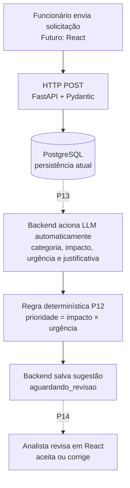

# Plano de Estudos e Dicas | AI Request Classifier

**Versão:** 3.53
**Atualização:** 15/10/2026
**Responsável:** desenvolvedor do AI Request Classifier
**Situação:** P01–P11 concluídas; **P12 com 20 testes específicos e 25 testes totais aprovados (saídas do desenvolvedor), compreensão avaliada, aguardando revisão Git, commit e push.**

## Objetivo de negócio

Plataforma de triagem de solicitações internas. Funcionário cadastra título e descrição; backend registra; IA será **acionada automaticamente após o cadastro**, sugerirá categoria, prioridade e justificativa; analista **aceitará ou corrigirá** via React. Classificar não equivale a resolver. Ainda não existe integração com IA, frontend React nem fluxo de revisão.

## Arquitetura integrada



**Hoje:** o CRUD FastAPI/PostgreSQL está implementado conforme confirmação do desenvolvedor. P12 apenas prepara regras e casos locais; não altera endpoint, banco ou persistência.

## Método de aprendizagem — atualizado

- **Aula integral e concisa:** conceitos essenciais, um diagrama integrado, código necessário, testes, perguntas de compreensão, indicação de commit e status final do que falta para o MVP.
- O desenvolvedor escreve, executa e versiona o código; o orientador revisa. Evitar repetir pré-requisitos dominados.
- Agrupar entregas para **reduzir o número de aulas**, sem remover componentes previstos. Pausar após cada aula para validação e autorização da próxima.
- Arquivos Markdown são entregues **completos, prontos para substituir**, não como remendos. Não presumir que arquivos baixados tenham sido sincronizados com repositório local.
- Não publicar senhas, tokens, dados reais ou `.env`; GitHub **privado até conclusão e auditoria final**, conforme decisão de 15/10/2026.

## Etapas já concluídas

| Etapa   | Conteúdo                                                        | Estado                                                                                                    |
| ------- | --------------------------------------------------------------- | --------------------------------------------------------------------------------------------------------- |
| P01–P05 | Git, Python, tipos, condições, HTTP e JSON                      | Concluídas                                                                                                |
| P06–P08 | FastAPI, CRUD e validação HTTP                                  | Concluídas                                                                                                |
| P09     | Organização modular e pytest                                    | Concluída                                                                                                 |
| P10     | PostgreSQL 18.6, banco, schema e SQL                            | Concluída                                                                                                 |
| P11     | Conexão FastAPI–PostgreSQL, SQL parametrizado e testes isolados | Concluída conforme confirmação; teste específico após reiniciar Uvicorn não foi documentado separadamente |

**Evidências Git conhecidas:** commit da P11 `62d5b7a`, `main` e `origin/main` coincidentes na consulta recebida; `.gitignore` exclui `backend/.env`, sem rastreamento conhecido; varredura exploratória de segredos não é auditoria final. PostgreSQL Windows local em `127.0.0.1:5433`; outra instância via Docker na porta 5432.

## Roadmap condensado — somente 4 aulas restantes

| Etapa   | Entrega e critérios                                                                                                                                                                | Estado                                  |
| ------- | ---------------------------------------------------------------------------------------------------------------------------------------------------------------------------------- | --------------------------------------- |
| **P12** | Taxonomia, matriz de prioridade, 10 casos de referência, 20 testes locais; regras documentadas                                                                                     | **Testes aprovados; falta commit/push** |
| **P13** | Integração LLM via API, JSON estruturado, custo/latência/privacidade, **acionamento automático no cadastro**, persistência da sugestão, falhas e fallback                          | Pendente                                |
| **P14** | API de revisão, status de triagem, aceitar/corrigir, React com formulário, listagem e pipeline integrado                                                                           | Pendente                                |
| **P15** | Regressão e avaliação da IA, segurança e confiabilidade, documentação comercial, demonstração, métricas, auditoria de segredos/histórico, licença e publicação **sob autorização** | Pendente                                |

O agrupamento torna as aulas maiores e pode exigir correções dentro da mesma aula. Não esconder atividades ou reduzir critérios de qualidade.

## P12 — Conteúdo e arquivos

**Categorias:** `suporte_ti`, `acessos_permissoes`, `financeiro`, `recursos_humanos`, `outros`. **Impacto:** `individual`, `equipe`, `empresa`. **Urgência:** `baixa`, `media`, `alta`. **Prioridade:** `baixa`, `media`, `alta`.

| Impacto / Urgência | Baixa | Média | Alta  |
| ------------------ | ----- | ----- | ----- |
| Individual         | baixa | baixa | média |
| Equipe             | baixa | média | alta  |
| Empresa            | média | alta  | alta  |

A matriz é didática, não SLA oficial. A categoria expressa **o assunto**, a prioridade expressa **a necessidade relativa de atendimento**. A palavra “urgente” sozinha não é evidência suficiente.

**Arquivos a implementar manualmente:**

```text
backend/app/classificacao.py
backend/evaluation/casos_referencia.json
backend/tests/test_classificacao.py
docs/CRITERIOS_CLASSIFICACAO.md
```

**Testes executados e confirmados por saída do PowerShell em 15/10/2026:** `pytest tests/test_classificacao.py -q` → **20 passed in 0.09s**; `pytest -q` → **25 passed in 2.16s**. Cobrem 9 combinações da matriz + 1 verificação estrutural + 10 verificações dos exemplos, além dos 5 testes de API anteriores. A suíte aprovada indica ausência de regressões **nos casos cobertos**, não prova ausência de bugs ou acurácia de LLM.

**Prática:** escrever `Enum` para categorias, impacto, urgência, prioridade; dicionário `MATRIZ`; função pura `calcular_prioridade(impacto, urgencia)`; salvar JSON de 10 exemplos sintéticos; criar testes; executar `python -m pytest tests/test_classificacao.py -q` e `python -m pytest -q` dentro de `backend`.

**Compreensão validada em 15/10/2026:** 4 respostas A–D avaliadas: B e C corretas; A recebeu complemento sobre **impacto + urgência**; D recebeu esclarecimento de que exemplos ajudam a **avaliar** uma LLM, não necessariamente a treiná-la. O desenvolvedor demonstrou compreensão suficiente para seguir. Não requer repetir exercícios.

**Git — ainda pendente de evidência da P12:** após sincronizar o documento público completo `docs/PLANO_DE_ESTUDOS_E_DICAS.md`, verificar `git status -sb`, `git diff --check`; adicionar **somente** `backend/app/classificacao.py`, `backend/evaluation/casos_referencia.json`, `backend/tests/test_classificacao.py`, `docs/CRITERIOS_CLASSIFICACAO.md` e `docs/PLANO_DE_ESTUDOS_E_DICAS.md`; conferir `git diff --cached --name-only` e `git diff --cached --check`; revisar e, se estiver tudo certo, usar commit `feat: define taxonomia e criterios de prioridade` e `git push origin main`. Confirmar hash e estado do Git antes de considerar P12 concluída. `PROMPT_*.md` permanece privado e fora do Git.

## Estado geral e próximos marcos

- **Implementado:** backend CRUD HTTP persistido em PostgreSQL, validações, testes de API, estrutura modular e documentação.
- **Implementação P12 validada em testes:** taxonomia, matriz e casos de referência; não altera ainda endpoints ou banco; não há classificação de texto por IA.
- **Falta imediatamente:** conferir staging, commit e push de P12, sem incluir o prompt privado ou segredos.
- **Ainda não implementado:** chamada automática de LLM e persistência de classificação (P13), fila de revisão humana e React (P14), qualidade/auditoria/publicação (P15).
- **Próximo marco após commit de P12:** iniciar P13 somente mediante autorização do desenvolvedor. O repositório permanecerá privado até o MVP completo e a auditoria final.

## Referências

- [README](../README.md)
- [Arquitetura](ARQUITETURA.md)
- [Critérios de classificação](CRITERIOS_CLASSIFICACAO.md)
- [FastAPI](https://fastapi.tiangolo.com/)
- [pytest](https://docs.pytest.org/)
- [PostgreSQL](https://www.postgresql.org/docs/)
