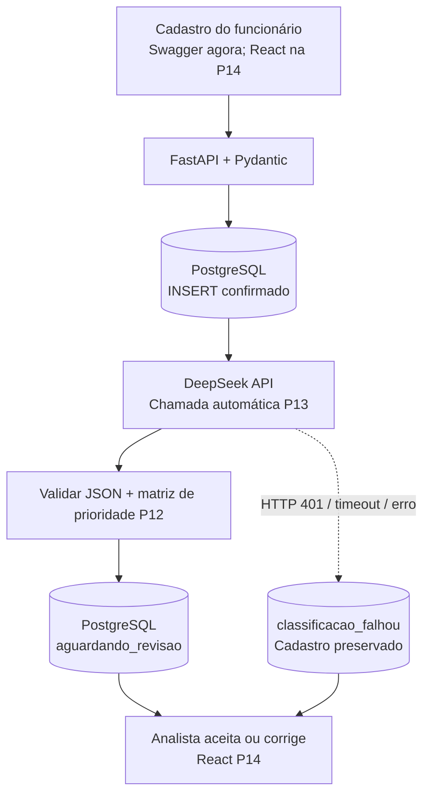

# Plano de Estudos e Dicas | AI Request Classifier

**Versão:** 3.58
**Atualização:** 15/10/2026
**Estado:** P01–P12 concluídas. P13 com classificação real e fallback confirmados; testes integrados finais, GET de conferência e commit/push pendentes.

## Objetivo empresarial e técnico

MVP de triagem corporativa: funcionário envia título e descrição pelo React → FastAPI/Pydantic valida → PostgreSQL confirma o cadastro → backend chama automaticamente a DeepSeek → valida categoria, impacto, urgência e justificativa → matriz P12 determina prioridade → PostgreSQL persiste a sugestão → analista aceita ou corrige. Se a IA falhar, a solicitação não é perdida. A classificação **não** resolve o chamado.

## Arquitetura de referência



## Método de estudo

Aulas curtas, termos essenciais, código e documentos completos, testes, revisão do Git e exercícios de compreensão. Cada etapa termina com um status do que falta até o MVP. Prompts de continuidade são privados e não entram no repositório. GitHub privado até a P15 e autorização expressa.

## Histórico técnico validado

- **P01–P09:** fundamentos, FastAPI, Pydantic, CRUD, arquitetura inicial e testes.
- **P10–P11:** PostgreSQL Windows `127.0.0.1:5433`, SQL parametrizado com psycopg, persistência e banco de testes isolado; commit P11: `62d5b7a`.
- **P12:** categorias, impacto, urgência, matriz determinística de prioridade, dez casos de referência; 20 testes específicos e 25 testes no total aprovados; exercícios, commit e push confirmados.

## P13 — resultados reais de 15/10/2026

**Entregas implementadas e observadas pelo desenvolvedor:**

1. **Fallback:** solicitação #8 recebeu `POST 201` apesar do erro DeepSeek `http_401`. Estado `classificacao_falhou`, sem sugestão IA, cadastro preservado.
2. **Correção de configuração:** o PowerShell tinha variável `DEEPSEEK_API_KEY` conflitante com `backend/.env`. O comando `Remove-Item Env:\DEEPSEEK_API_KEY -ErrorAction SilentlyContinue` foi executado e o novo POST funcionou. Nenhum segredo foi compartilhado.
3. **Classificação real:** solicitação #13, "Sistema financeiro indisponível", recebeu `aguardando_revisao`, categoria `suporte_ti`, impacto `equipe`, urgência `alta`, prioridade `alta`, justificativa coerente e modelo `deepseek-flash`.
4. **Métricas desta única execução:** `tokens_entrada=329`, `tokens_saida=54`, `latencia_ia_ms=1012`. Não extrapolar um único resultado para SLA ou custo médio.
5. **Compreensão:** exercícios A–D da P13 respondidos adequadamente. JSON válido não garante classificação semanticamente correta; prioridade segue regra Python; timeout não deve excluir cadastro.

**Ainda falta comprovar na P13:**

- GET `/solicitacoes/13` com a mesma sugestão armazenada.
- `pytest -q` completo após os arquivos P13, com PostgreSQL de testes acessível, `AI_ENABLED=false` e mock das chamadas externas.
- Revisar staging, `.env.example` sem segredo, documentação, commit e push.

Comandos na pasta `backend`:

```powershell
$env:AI_ENABLED = "false"
.\.venv\Scripts\python.exe -m pytest -q
Remove-Item Env:\AI_ENABLED -ErrorAction SilentlyContinue
```

**Mensagem de commit planejada:** `feat(ai): integra classificacao automatica e persistencia com fallback`. Não executar commit antes de confirmar a suíte completa.

## Roadmap restante

| Etapa | Entrega                                                                                                    | Estado                                                |
| ----- | ---------------------------------------------------------------------------------------------------------- | ----------------------------------------------------- |
| P13   | LLM real, persistência, fallback, testes e Git                                                             | Fluxo real e fallback OK; validações finais pendentes |
| P14   | React, cadastro, fila de revisão, aceitar/corrigir sugestões                                               | Pendente                                              |
| P15   | Avaliação com casos P12, métricas, segurança, README comercial, auditoria, licença e publicação autorizada | Pendente                                              |

## Dicas de qualidade

- Testes não devem chamar a DeepSeek real nem consumir créditos; usar simulações e banco `ai_request_classifier_test` exclusivamente para dados descartáveis.
- Não expor senha PostgreSQL ou chave DeepSeek, nem colocá-las no Git ou em logs. Verificar `.env` ignorado antes de commit.
- O POST síncrono incorpora latência da IA; filas, retentativas e processamento assíncrono são pontos de melhoria, não requisitos adicionais agora.
- Sugestão da IA é provisória e precisa de revisão humana. Medir acertos por campo (categoria, prioridade etc.) na P15.

**Progresso por aulas:** 12/15 (80%). Não representa 80% do MVP funcional. Próxima ação: GET, suíte completa P13 e revisão/commit/push.
