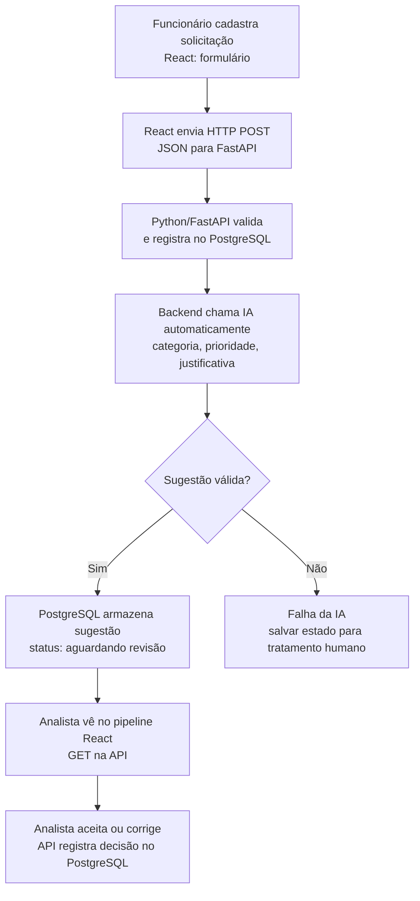

# Plano de Estudos e Dicas | AI Request Classifier

**Versão:** 3.17  
**Atualização:** 13/10/2026  
**Responsável:** desenvolvedor do AI Request Classifier  
**Estado:** P01 a P04 concluídas; P05 não iniciada. Commit da P04 pendente.

## Objetivo

Construir incrementalmente uma aplicação para triagem de solicitações internas. O funcionário cadastra uma solicitação; o backend registra e **aciona automaticamente a IA** para sugerir categoria, prioridade e justificativa. O analista visualiza as sugestões no pipeline React e pode aceitar ou corrigir. A classificação não equivale à resolução do chamado.

## Arquitetura pretendida e processo empresarial

**Atenção:** o diagrama representa a **arquitetura planejada**, não uma funcionalidade pronta. Até a P04, há apenas exercícios locais de Python; FastAPI, PostgreSQL, modelo de IA e React ainda não foram implementados.

## Método de trabalho

O desenvolvedor digita e executa o código do backend, verifica resultados e explica os conceitos com suas palavras. Orientação em ciclos de 3 a 5 passos, explicações curtas, exercícios pequenos e revisão antes de avançar de aula. O frontend poderá ser construído com assistência de IA, sem ocultar a comunicação com o backend.

Para cada fluxo, preferir **um único diagrama integrado**, com o evento empresarial, componente técnico, dados enviados, estado e retorno. Evitar excesso de teoria e repetição.

## Trilha prática

- [ ] **P00:** problema empresarial e arquitetura. Apresentada; avaliação formal não realizada e avanço autorizado.
- [x] **P01:** estrutura, Git e GitHub, `.gitignore`, README e documentação. Concluída por evidências e confirmações.
- [x] **P02:** Python 3.14.7, ambiente `.venv`, primeiro script, variáveis e `print()`. Concluída.
- [x] **P03:** `str`, `int`, `bool`, dados de solicitações e atribuição. Concluída.
- [x] **P04:** `if/else`, `in`, `lower()`, funções `def`, parâmetros e `return`. **Concluída em 13/10/2026.**
- [ ] **P05:** HTTP, JSON, requisições e respostas.
- [ ] **P06:** FastAPI e primeiro endpoint.
- [ ] **P07:** receber dados por POST e validar.
- [ ] **P08:** CRUD de solicitações em memória.
- [ ] **P09:** organização de arquivos, commits e documentação técnica.
- [ ] **P10:** PostgreSQL e SQL aplicados.
- [ ] **P11:** persistência e consultas parametrizadas.
- [ ] **P12:** categorias, prioridades e exemplos de avaliação.
- [ ] **P13:** API de IA, prompts, dados enviados, segurança e custos.
- [ ] **P14:** classificação automática e tratamento de falhas.
- [ ] **P15:** pipeline de revisão humana.
- [ ] **P16:** interface React.
- [ ] **P17:** integração completa cadastro -> IA -> revisão.
- [ ] **P18:** testes, qualidade e segurança.
- [ ] **P19:** documentação final, demonstração e revisão técnica.
- [ ] **P20:** eventual publicação, após autorização.

## Evidências de progresso e Git

| Etapa | Resultado confirmado | Git |
|---|---|---|
| P01 | Repositório inicializado, documentação e `.gitignore` configurados | Primeiro commit `a38d48c`, push confirmado |
| P02 | Execução do Python e ambiente virtual confirmados pelo desenvolvedor | Sem commit específico informado |
| P03 | Três respostas corretas e `main.py` executado | Commit `a63e068`; push confirmado por relato |
| P04 | `if/else` e função `sugerir_categoria(titulo)` compreendidos; duas execuções confirmadas por relato (`Suporte de TI` e `Outros`) | **Commit e push pendentes** |

A regra de `sugerir_categoria(titulo)` é um exercício **determinístico** de palavra-chave e **não é classificação por IA**. Ela não contempla prioridade nem revisão humana. Estas funcionalidades serão implementadas em etapas posteriores.

**Repositório:** [ai-request-classifier](https://github.com/waldirevora/ai-request-classifier). Decisão do desenvolvedor: manter privado até o MVP estar pronto e a revisão de segurança autorizar a mudança. A visibilidade não foi verificada independentemente pelo orientador.

## Git: boas práticas e mensagens

- Antes de um commit, executar `git status --short` e revisar `git diff` e os arquivos escolhidos para staging.
- Fazer staging seletivo e conferir com `git diff --cached --check` e `git diff --cached --stat`.
- Mensagens em português com prefixos `feat:`, `fix:`, `docs:`, `test:` e `refactor:`.
- Após criar o commit, conferir `git log -1 --oneline` e `git status`.
- Fazer push para o GitHub privado somente após validar o conteúdo do commit.
- Nunca publicar `.env`, credenciais, `.venv/` nem documentos internos. Antes de tornar o repositório público, revisar todo o histórico, não só os arquivos atuais.

**Próximo commit sugerido:** `feat: adiciona funcao de classificacao provisoria`, após inspeção de `backend/app/main.py`. Este guia atualizado pode receber um commit de documentação separado (`docs: atualiza progresso ate P04`).

## Dicas de desenvolvimento e anotações

Anotar para cada etapa: objetivo, ideia principal, conceitos/símbolos, diagrama negócio + técnica, comandos/código escritos, saída observada, erro/correção, decisão e dúvida.

Práticas recomendadas: prever resultados antes de executar, modificar um caso de cada vez, descrever com suas próprias palavras por que o programa produziu a saída e revisar conceitos sem consultar o código. Avançar conforme a compreensão real, não pelo volume de linhas.

## Estado técnico conhecido

- Windows, VS Code, PowerShell e Python 3.14.7.
- `backend/app/main.py`: exercícios locais em Python, com código da P04 confirmado como executado pelo desenvolvedor; conteúdo não inspecionado remotamente.
- `backend/.venv/`: ambiente criado e validado pelo desenvolvedor, ignorado pelo Git.
- FastAPI, PostgreSQL, IA, React e testes automatizados: **não iniciados**.

## Próxima etapa

**Primeiro:** revisar alterações da P04 e criar o commit/push correspondente. **Depois:** iniciar P05 (HTTP e JSON) somente quando o desenvolvedor autorizar. O guia deve ser atualizado e versionado conforme o progresso, sem presumir sincronização automática com os arquivos locais.

## Referências

- [README do projeto](../README.md)
- [Documentação oficial do Python](https://docs.python.org/pt-br/3/)
- [Documentação oficial do Git](https://git-scm.com/docs)
