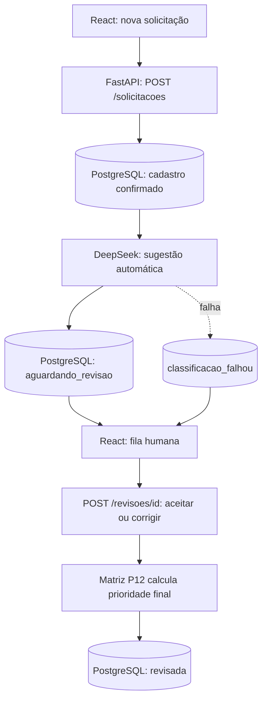

# Plano de Estudos e Dicas | AI Request Classifier

**Versão:** 3.61
**Estado:** P01–P13 concluídas. **P14 funcionalmente validada no computador do desenvolvedor:** revisão humana operante, 41 testes Python aprovados e build React aprovado; pendente revisão do Git, commit e push. P15 pendente. GitHub privado até finalização, auditoria e autorização expressa.

## Objetivo empresarial

Triagem interna: funcionário registra solicitação; backend persiste e aciona IA DeepSeek; IA sugere categoria/impacto/urgência/justificativa; matriz de negócio define prioridade; analista aceita ou corrige em React; sistema grava resultado final no PostgreSQL. Classificação não equivale à resolução do chamado.

## Fluxo integrado P14

## Método das aulas

- Aulas curtas, porém com **explicação de conceito, motivo, fluxo entre arquivos e teste**.
- Fornecer arquivos completos para substituição, não fragmentos isolados (inclusive `README.md`, `ARQUITETURA.md`, este plano e o prompt privado).
- Developer executa/entende o código localmente; não declarar resultados de testes que ele ainda não confirmou.
- Fazer avaliação de compreensão e orientar commit/push **após** os testes e revisão de segurança.
- Encerrar toda aula com status do que falta para o MVP.

## Histórico

| Etapa | Entregas | Situação |
|---|---|---|
| P01–P09 | Fundamentos, FastAPI, CRUD Pydantic, testes e organização | Concluída |
| P10–P11 | PostgreSQL Windows 18.6 na porta 5433, persistência, consultas parametrizadas e testes isolados | Concluída; commit P11 `62d5b7a` |
| P12 | Cinco categorias, matriz impacto+urgência, dez casos de referência, 25 testes totais naquela etapa | Concluída; commit e push confirmados |
| P13 | DeepSeek `deepseek-flash`, chamada automática, fallback, persistência de classificação e métricas | Concluída; commit e push confirmados |
| **P14** | **React, cadastro, fila do analista, aceite/correção, revisão persistida, testes** | **Validada funcionalmente; falta versionar** |
| P15 | Avaliação da IA, testes E2E, desempenho/custos, documentação final, segurança e eventual publicação | Pendente |

## P13 — evidências principais

POST #8: DeepSeek retornou HTTP 401, mas FastAPI preservou cadastro (`201`, `classificacao_falhou`). Correção da variável PowerShell conflitante com `backend/.env` permitiu chamada posterior bem-sucedida. POST #13: `aguardando_revisao`, categoria `suporte_ti`, impacto `equipe`, urgência `alta`, prioridade `alta`, 329 tokens de entrada, 54 de saída, 1.012 ms de latência observada. Conclusão e commit/push P13 confirmados pelo desenvolvedor; hash não informado.

## P14 — conceitos e decisões

- **React:** biblioteca que renderiza componentes da interface; `useState` guarda estado visual; `useEffect` busca dados ao abrir; `fetch` envia HTTP à FastAPI.
- **Vite:** servidor de desenvolvimento; o proxy transforma `/api/revisoes` no endpoint real `http://127.0.0.1:8000/revisoes`, evitando CORS local.
- **Revisão humana (human-in-the-loop):** a IA sugere; o analista valida/corrige. O backend recalcula prioridade pela matriz P12, independentemente do frontend.
- **Migração SQL 003:** adiciona campos finais e informações de revisão sem apagar registros anteriores. Aplicar nas bases principal e isolada antes dos testes.
- **Integridade e concorrência:** `SELECT ... FOR UPDATE` mantém bloqueio durante decisão; revisões duplicadas retornam HTTP 409.
- **Fallback manual:** quando `classificacao_falhou` ou a IA está desativada, o analista pode classificar manualmente em vez de aceitar uma sugestão inexistente.
- **Segurança:** a chave DeepSeek permanece no backend `.env`. Sem autenticação, manter o MVP exclusivamente em localhost; nenhuma exposição pública.

## Evidências P14 e ações finais

- Migração SQL 003 utilizada no PostgreSQL de desenvolvimento e de testes; o frontend exibiu dados reais da API.
- Renderização React corrigida adicionando `React` à importação inicial de `frontend/src/App.jsx`.
- Fluxo manual de revisão testado com sucesso conforme confirmação do desenvolvedor; registros artificiais #6–#11 excluídos via `DELETE /solicitacoes/{id}`.
- `pytest -q` com `AI_ENABLED=false`: **41 passed in 5.30s**.
- `npm run build`: Vite **6.4.4**, **25 módulos**, **built in 1.39s**.
- `git diff --check` identificou **um erro de whitespace** em `docs/PLANO_DE_ESTUDOS_E_DICAS.md:3`; versão 3.61 elimina espaços finais. Avisos de normalização LF/CRLF não bloqueiam commit.
- Antes do commit: verificar arquivos que serão adicionados, preservar `frontend/package-lock.json`, ignorar `frontend/node_modules/` e `frontend/dist/`, verificar `backend/.env` e estágio; commit e push só depois de verificação limpa.
- Mensagem sugerida: `feat(web): implementa interface React e revisao humana`.

## Ambiente e cautelas

Windows PowerShell em `D:\Projects\ai-request-classifier`; Python 3.14.7 em `backend/.venv`; PostgreSQL Windows 5433 versus Docker 5432. Quando `psql` não for encontrado: `$env:Path += ";C:\Program Files\PostgreSQL\18\bin"`. Bancos: `ai_request_classifier` (desenvolvimento), `ai_request_classifier_test` (testes, TRUNCATE DESTRUTIVO SOMENTE AQUI). `backend/.env` gitignored e deve permanecer sem rastreamento; prompt de continuidade privado também fora do Git. Não expor aplicação sem autenticação a redes públicas.

## Status atual do MVP

**13/15 etapas oficialmente concluídas** (86,7% das etapas, não das funcionalidades). P14 funcionalmente testada, faltam staging seguro, commit e push. P15 pendente: avaliação da IA, métricas, testes ponta a ponta, segurança, documentação comercial, auditoria de histórico, licença e publicação somente com autorização.
