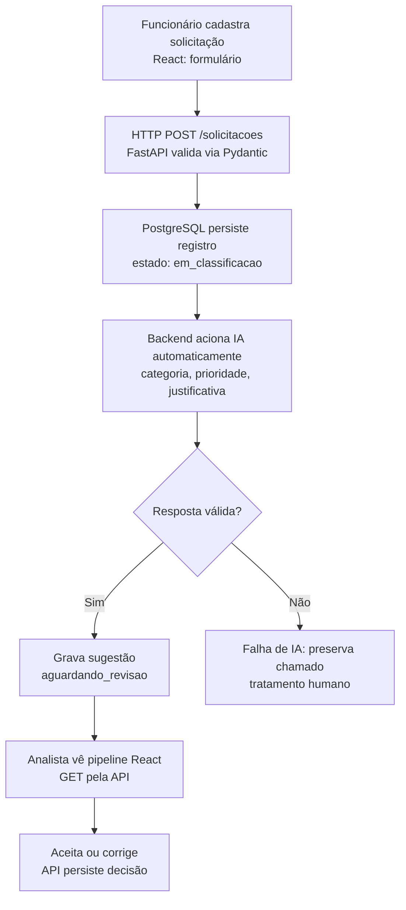

# Plano de Estudos e Dicas | AI Request Classifier

**Versão:** 3.31
**Atualização:** 14/10/2026
**Responsável:** desenvolvedor do AI Request Classifier
**Estado:** P01 a P08 concluídas conforme confirmação do desenvolvedor. **P09 em andamento:** cinco testes automatizados executados e aprovados no ambiente do desenvolvedor; há um aviso de depreciação de dependência; Swagger, documentação e compreensão ainda aguardam validação.

## Objetivo do produto

Aplicação de triagem de solicitações internas de empresas. Funcionário cadastra título e descrição; backend valida e armazena; **IA é acionada automaticamente após o cadastro** e sugere categoria, prioridade e justificativa; analista recebe a sugestão no pipeline React e aceita ou corrige. Classificação não equivale a atendimento concluído. Nenhum clique do analista será necessário para iniciar a classificação.

## Arquitetura integrada de referência (planejada)



**Já implementado conforme confirmação do desenvolvedor:** Python local, FastAPI/Uvicorn, `GET /health`, POST, GET lista/detalhe, PUT e DELETE em `/solicitacoes`, validação Pydantic, 200/201/204/404/422, contador de IDs e lista temporária em memória. **Ainda não implementados:** React, PostgreSQL, serviço de IA, pipeline e classificação automática.

## Método de aprendizagem

- O **desenvolvedor** digita e executa pessoalmente o backend, os testes e os comandos Git; o orientador explica, revisa e registra decisões.
- Apresentar a **aula inteira de uma vez**: objetivo, conceitos essenciais, **diagrama único com fluxo empresarial e técnico**, prática incremental, testes, exercício e indicação de commit.
- Manter a explicação breve e tecnicamente precisa, sem pular conceitos novos. Erros são diagnosticados antes de avançar.
- **Não concluir uma aula sem prática e compreensão confirmadas**; não avançar sem autorização.
- Nunca publicar segredos, tokens ou dados privados; o GitHub permanecerá privado até revisão e autorização.

## Trilha prática

- [ ] **P00:** problema empresarial e arquitetura. Apresentada; sem avaliação formal, avanço autorizado.
- [x] **P01:** projeto, Git, GitHub privado, README e `.gitignore`.
- [x] **P02:** Python 3.14.7, `.venv`, execução de script.
- [x] **P03:** variáveis, `str`, `int`, `bool`.
- [x] **P04:** `if/else`, palavras-chave e funções (`def`, `return`).
- [x] **P05:** HTTP/JSON, dicionário e `json.dumps()`.
- [x] **P06:** FastAPI/Uvicorn, `GET /health`, `/docs` e testes HTTP.
- [x] **P07:** `POST /solicitacoes`, Pydantic, `201`/`422`, lista em memória; **commit e push informados como concluídos**.
- [x] **P08:** GET lista/detalhe, PUT, DELETE, erros 404/422, resposta 204 e IDs crescentes; 5/5 respostas e testes confirmados; commit/push informados.
- [ ] **P09: em estudo.** Organização em módulos, testes automatizados com pytest/TestClient, README, arquitetura e Git. Desenvolvedor apresentou execução local de cinco testes com sucesso e um aviso de depreciação; demais critérios pendentes.
- [ ] **P10:** PostgreSQL e SQL aplicado.
- [ ] **P11:** persistência e consultas parametrizadas.
- [ ] **P12:** categorias, prioridades e exemplos de avaliação.
- [ ] **P13:** API de IA, instruções, custo, latência e privacidade.
- [ ] **P14:** classificação automática e tratamento de falhas.
- [ ] **P15:** revisão humana e estados do pipeline.
- [ ] **P16:** interface React.
- [ ] **P17:** integração React → API → IA → revisão.
- [ ] **P18:** testes, qualidade e segurança.
- [ ] **P19:** documentação e demonstração técnica.
- [ ] **P20:** publicação somente após autorização.

## P08 concluída em 14/10/2026

- **Testes manuais:** desenvolvedor confirmou que todos funcionaram, incluindo POST 201, GET lista/detalhe 200, PUT 200, DELETE 204, 404/422, ID crescente após exclusão e `/health`.
- **Compreensão:** cinco respostas corretas: GET/PUT/DELETE; 404 para ID inexistente e 422 para parâmetro inválido; contador evita duplicação durante um processo; estado em memória é perdido após reinício; não existe IA automática ainda.
- **Git:** `git add`, commit e push P08 informados como concluídos pelo desenvolvedor. Não foram fornecidos hashes, mensagem final ou saída dos comandos; não alegar conferência independente.

## P09 em estudo: código modular, testes e documentação

**Objetivo:** refatorar sem alterar comportamento. Separar a aplicação FastAPI, os schemas Pydantic, os dados temporários e as rotas. Automatizar testes de regressão e registrar o funcionamento real do protótipo.

**Estrutura proposta na aula:**

```text
backend/
  app/
    __init__.py
    main.py                # FastAPI, /health, include_router
    schemas.py             # campos e regras Pydantic
    storage.py             # lista, contador_ids e busca
    routes/
      __init__.py
      solicitacoes.py      # APIRouter: POST, GET lista/detalhe, PUT e DELETE
  tests/
    test_api.py            # 5 testes automatizados
  requirements.txt        # fastapi, uvicorn
  requirements-dev.txt    # referencia requirements.txt, pytest, httpx2
docs/
  ARQUITETURA.md           # visão de negócio, módulos, limites e próximos passos
  PLANO_DE_ESTUDOS_E_DICAS.md
README.md                  # atualizar com comandos, problema e estado real
```

**Conceitos:** módulo, pacote, responsabilidade única, import, router, refatoração sem mudar funcionalidade, testes de regressão e teste de API sem servidor real via `TestClient`.

**Regras da refatoração:** manter `GET /health`; `POST /solicitacoes` 201; `GET /solicitacoes` e GET por ID 200; `PUT` 200; `DELETE` 204 sem corpo; 404/422; `status: pendente_classificacao`; validações de título (3–120) e descrição (10–2000); IDs crescentes na mesma execução. Usar `from app import storage` para compartilhar o estado do módulo e `APIRouter(prefix="/solicitacoes")` para registrar as rotas. Nenhum banco, React ou IA nessa etapa.

**Testes previstos:** cinco funções `pytest`: (1) saúde/lista vazia; (2) cadastro e GET lista/detalhe; (3) entradas inválidas/ID inexistente; (4) edição e exclusão; (5) contador de ID após exclusão. `setup_function` deve limpar a lista e reiniciar o contador a cada teste para evitar dependência de ordem. Rodar no terminal em `backend`: `.\.venv\Scripts\python.exe -m pytest -q`. `TestClient` usa HTTP simulado em processo; verificação manual opcional de `/docs` com servidor Uvicorn. A referência foi executada isoladamente pelo orientador com cinco testes aprovados; **a execução local foi informada em 14/10/2026: cinco testes passaram, com um aviso de depreciação**.

**Documentação:** README deverá explicar problema de negócio, o que já funciona, endpoints, setup/testes, limitações e próximos passos. `docs/ARQUITETURA.md` documentará responsabilidades e evolução planejada. Não inventar custos ou latências ainda não medidos. Guia público será sincronizado manualmente; prompt interno não deve ser versionado.

**Concluir P09 somente se:** estrutura efetivamente criada, comportamento do CRUD mantido, testes locais 5/5, documentação revisada, entendimento demonstrado e Git validado conforme relato do desenvolvedor.

## P09: evidência local recebida e ajuste de dependência (14/10/2026)

- O desenvolvedor executou `(.venv) PS D:\Projects\ai-request-classifier\backend> .\.venv\Scripts\python.exe -m pytest -q` e forneceu o resultado **`5 passed, 1 warning in 0.73s`**. Os cinco testes automatizados da P09 passaram; não foi enviada saída de verificação Swagger ou de Git nesta etapa.
- Aviso observado: `StarletteDeprecationWarning: Using httpx with starlette.testclient is deprecated; install httpx2 instead` (em `fastapi/testclient.py`). **Aviso de dependência, não falha dos testes.** A documentação oficial da Starlette informa que o `TestClient` passou a usar `httpx2` e que o `httpx` antigo ainda funciona, mas é depreciado: https://starlette.dev/testclient/.
- **Ajuste recomendado:** em `backend/requirements-dev.txt` trocar `httpx` por `httpx2` (manter `-r requirements.txt` e `pytest`); reinstalar via ambiente virtual e repetir `pytest -q`. Não suprimir o warning nem alterar os testes por esse motivo. Confirmar depois se o aviso desapareceu; não presumir antes da execução.
- **P09 permanece em estudo:** conferir `/docs` e endpoints após modularização, revisar README/`docs/ARQUITETURA.md`, responder A–F, revisar staging e então versionar.

## Git e evidências

- Raiz informada: `D:\Projects\ai-request-classifier`, Windows/PowerShell/VS Code; venv em `backend/.venv`. Utilizar executável da venv, não o launcher `py` quebrado.
- Git `main`, origem informada `https://github.com/waldirevora/ai-request-classifier.git`, repo privado segundo decisão; visibilidade não auditada.
- Commits conhecidos com hashes: inicial `a38d48c`, P03 `a63e068`. Demais hashes não fornecidos.
- P04 a P08 e documentação pós-P07: commits e pushes concluídos conforme relato do desenvolvedor; não inventar saída, hashes, staging ou sincronização remota auditada.
- **P09:** nenhum commit/push informado até esta versão. Após testes e revisão, verificar `git status --short`, `git diff`, `git add` seletivo, `git diff --cached --check`, `git diff --cached --name-only`, `git commit -m "refactor: organiza backend e adiciona testes automatizados"`, `git push origin main`, `git status -sb`.
- Não versionar `.env`, segredos, `.venv`, `__pycache__`, dados reais nem arquivos `PROMPT_*.md`. Confirmar `.gitignore` e staging. Documentos gerados no chat não entram no repositório automaticamente.

## Próximo passo imediato

**Corrigir a dependência dev de testes (httpx2), repetir `pytest -q` e concluir a aula P09.** Encaminhar verificação do `/docs`, documentação e respostas A–F. Revisar antes de concluir a aula. **P10 não iniciada; precisa de autorização expressa.**

## Dicas para registro no caderno

Registrar objetivo da refatoração, responsabilidades de `main.py`/`schemas.py`/`storage.py`/`routes/solicitacoes.py`, conceito de teste de regressão, diferença entre teste com `TestClient` e servidor Uvicorn, resultados efetivos, decisões e limitações de memória. Evitar confundir reorganização de código com criação de novas funcionalidades.

## Referências

- [README do projeto](../README.md)
- [Tutorial FastAPI](https://fastapi.tiangolo.com/pt/tutorial/)
- [Teste de aplicação FastAPI](https://fastapi.tiangolo.com/pt/tutorial/testing/)
- [Documentação pytest](https://docs.pytest.org/)
- [Documentação Python](https://docs.python.org/pt-br/3/)
