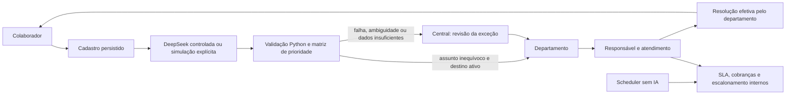

# SolicitaFlow V2 — contrato implementado

> **Registro histórico.** Este documento preserva o estado, os testes e as decisões
> da etapa em que foi produzido. Menções a operação somente local, publicação futura,
> simulação ou pendências valem para aquela etapa. O serviço atual está publicado;
> consulte [README](../README.md), [deploy e manutenção](DEPLOY_PUBLICO.md) e
> [encerramento do marco](ENCERRAMENTO.md) antes de executar qualquer roteiro antigo.

Solicitações inteligentes, do pedido à resolução.

O AI Request Classifier evoluiu para SolicitaFlow no mesmo repositório. O banco
`ai_request_classifier`, seus registros e as três migrações originais continuam
preservados. A V2 acrescenta entidades `sf_*`, sem reescrever o cadastro original.

## Fases entregues

| Fase | Comportamento implementado |
| --- | --- |
| V2.1 | Departamentos, categoria → destino, validação determinística, exceções, decisão única e eventos |
| V2.2 | Sessões locais, portais por perfil e autorização por recurso/ambiente no backend |
| V2.3 | Responsável, transições, primeira resposta, resolução, SLA, alertas internos e relatório |
| V2.4 | Laboratório isolado, personagens fictícios, relógio virtual e cenários automático/ambíguo |

## Arquitetura

`solicitacoes` guarda o pedido, a sugestão original e eventual decisão humana.
`sf_cases` guarda o atendimento e referencia o pedido uma única vez.
`sf_routes` contém um destino por categoria no ambiente; a FK composta impede
um destino pertencente a outro ambiente. `sf_routing_decisions` registra a
decisão inicial e eventual revisão; índice parcial único impede dois encaminhamentos.
`sf_events` é somente leitura/inserção para a role da aplicação.

A classificação não decide sozinha: o backend exige assunto compatível com
palavras explícitas, descrição suficiente, impacto/urgência sustentados quando
elevados, destino ativo e categoria sem exigência de revisão. Assuntos múltiplos,
`outros`, instruções suspeitas, destino ausente ou falha do provedor vão para
exceção. Essas heurísticas conservadoras não são um sistema semântico infalível;
devem ser avaliadas com um corpus antes de uso empresarial.

Não se utiliza confiança autodeclarada pelo modelo. A prioridade sempre passa
pela matriz existente em `backend/app/classificacao.py`, inclusive em revisões.
O tutorial espelha as nove células, comparadas ao Python pelo teste frontend.

## Identidade e isolamento

Perfis reais do laboratório local: `colaborador`, `departamento`, `central`.
Contas locais usam scrypt; sessões opacas são armazenadas somente pelo hash.
Cookies HttpOnly e SameSite=Strict: `sf_local` e `sf_lab`. O cabeçalho
`X-SolicitaFlow-Context` escolhe o contexto, mas não concede permissões: o
servidor exige cookie válido e confere o tipo do ambiente, conta e recurso.

Colaborador só consulta seus pedidos. Departamento só consulta sua fila; apenas
o responsável pode registrar andamento/resolução. Central só administra seu
ambiente. Recurso inexistente ou fora do escopo retorna 404. Operação incompatível
com o perfil retorna 403; transição inválida retorna 409.

Troca de personagens existe exclusivamente em ambientes `lab`, com contas
fictícias do próprio visitante. Não permite selecionar usuários locais ou de outro
visitante. A troca revoga a sessão anterior. Sessão do laboratório dura 2 horas;
seu ambiente expira em 24 horas. Expiração bloqueia o acesso; remoção física dos
dados depende de uma política de retenção futura e não é executada automaticamente.

A triagem clássica permanece disponível à central local; exclui pedidos V2 e
protege todos os endpoints de CRUD/revisão. `SF_SECURE_LEGACY=false` é reservado
à compatibilidade dos testes antigos, nunca ao serviço operacional.

## Pipeline e SLA fictício

`analisando → encaminhada → em_atendimento → resolvida`.
Uma exceção passa por revisão humana antes de `encaminhada`. É possível alternar
`em_atendimento ↔ aguardando_colaborador`. Só o departamento confirma resolução.
Assumir não equivale a responder: o primeiro registro de andamento ou resolução
marca a primeira resposta. Não há pausa de SLA ao aguardar colaborador.

| Prioridade | Primeira resposta | Resolução | Alerta antes do prazo | Escalonar após atraso |
| --- | ---: | ---: | ---: | ---: |
| Alta | 2 h | 8 h | 2 h | 4 h |
| Média | 8 h | 24 h | 4 h | 8 h |
| Baixa | 24 h | 72 h | 6 h | 24 h |

São horas corridas e parâmetros fictícios. Alterar uma política só afeta novos
encaminhamentos; pedidos existentes preservam prazos e snapshot. Scheduler de
usuário executa verificações a cada 60 segundos, sem DeepSeek, APT ou systemd.
Índice único `(case_id,kind)` torna cobranças/escalonamentos idempotentes.
Processamento interrompido por mais de cinco minutos vira exceção, sem repetir IA.

O relógio virtual só avança no ambiente fictício do visitante, até 720 horas por
ação e 8.760 no total. Não altera relógio do sistema, banco ou outro ambiente.
Eventos de atendimento/alerta incluem `effective_at` para registrar tempo simulado.
Relatórios exibem volume, resoluções, risco, atrasos e médias por departamento.
Notificações são internas ao produto; nenhuma mensagem é enviada a contatos reais.

## IA e custos

Todos os formulários V2 enviam `mode=simulacao`. O resultado é explicitamente
rotulado e registra modelo `simulacao-local`, tokens zero e nenhuma chamada externa.
A integração DeepSeek existente continua preservada, assim como a triagem clássica.

A API V2 só admite `mode=deepseek` com conta colaboradora local, chave presente,
`AI_ENABLED=true` e `SF_REAL_AI_ENABLED=true`. A reserva diária é atômica: no máximo
duas tentativas por ambiente local/dia, inclusive falhas. Chaves de idempotência
evitam repetir classificação do mesmo cadastro. Visitantes nunca têm esse acesso.
O legado pode consumir créditos quando a central local cria pedidos com IA ativa;
a cota V2 não se aplica ao legado. Mantenha-o restrito a operadores confiáveis.

Testes automatizados bloqueiam o transporte real da IA e usam mocks. A evolução
V2 não precisa de chamadas pagas para demonstrar seu fluxo completo.

## Migrações e compatibilidade

| Arquivo | Conteúdo |
| --- | --- |
| 001–003 | MVP original: 5, 15 e 22 colunas em solicitacoes |
| 004_routing.sql | Ambientes, departamentos, mapeamentos, casos, decisões e eventos |
| 005_identity.sql | Contas, sessões, rate limiting, cotas e vínculos de autoria/responsável |
| 006_workflow_sla.sql | Relógio fictício, políticas, prazos, resolução e notificações |

`scripts/migrate_v2.py` executa apenas as migrações aditivas novas, mantém cada
transação e grava checksum em `sf_schema_versions`. Reaplicar uma versão com
conteúdo diferente falha. Não utiliza `backend/migrate.py` legado de Railway.
Objetos do principal pertencem a `ai_classifier_owner` (NOLOGIN); testes, a
`ai_classifier_test`. FastAPI usa `ai_classifier_app`, sem DDL/TRUNCATE.

Aplicar o esquema requer conexão administrativa e contexto da role proprietária.
O runner exige PostgreSQL 18 e um dos dois nomes de banco conhecidos. Não concede
permissões automaticamente; o provisionamento deve conceder CRUD necessário,
USAGE das sequências, e somente SELECT/INSERT nos eventos. Não conceder TRUNCATE
à aplicação nem CONNECT do usuário de testes ao principal.

Para uma instalação já migrada, não execute novamente 001–003. Confira o catálogo
e o ledger. Rollback operacional deve reverter código compatível, preservando
tabelas e dados adicionados; não há migração destrutiva automática.

## Limites antes de qualquer publicação

Esta entrega é local. Não representa integração corporativa de produção.
Ainda exigem projeto/testes: TLS/cookies Secure, identidade corporativa e ciclo
de contas, provisionamento de empresas, recuperação de senha, MFA quando cabível,
auditoria administrativa externa, retenção/expurgo, backup e restauração verificados,
limites distribuídos com origem confiável, observabilidade, testes de carga e avaliação
de qualidade com dados autorizados. O rate limiting local não substitui esses controles.
Não há e-mail, mensageria externa, calendário empresarial ou integração de diretório.
Render + Neon permanecem planejamento; nenhum deploy público foi realizado.
